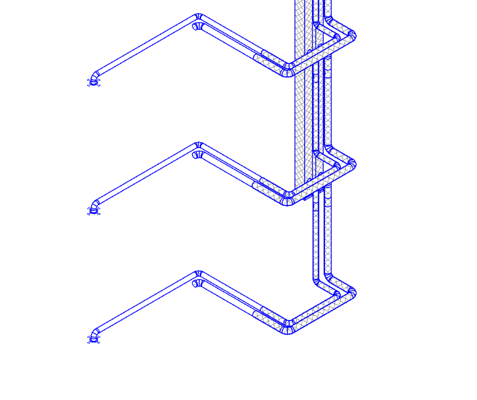
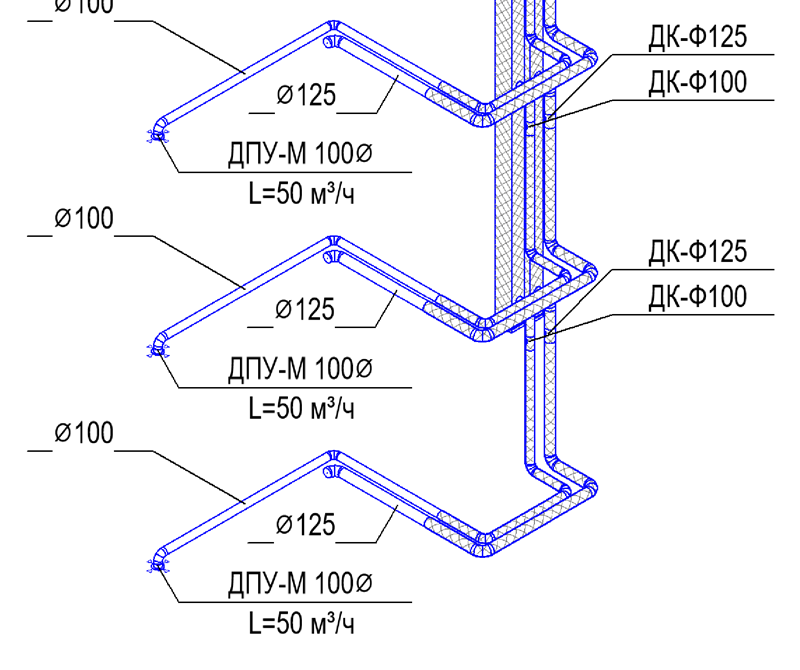

<p align="center">
  
</p>

<h1 align="center">ToadTools</h1>

<p align="center">
  Вкладка для Autodesk Revit 2020–2027 с инструментами,<br>
  которые делают скучную часть работы за проектировщика и BIM-координатора.
</p>

<p align="center">
  <a href="https://github.com/Alexpivo394/ToadTools/releases/latest"></a>
  <a href="https://github.com/Alexpivo394/ToadTools/actions/workflows/Compile.yml"></a>
  <a href="LICENSE.md"></a>
</p>

<p align="center">
  <b><a href="https://github.com/Alexpivo394/ToadTools.Desktop/releases/latest">Скачать</a></b> ·
  <a href="https://github.com/Alexpivo394/ToadTools/wiki">Инструкции</a> ·
  <a href="Changelog.md">Что нового</a>
</p>

---

Расставить марки на виде, проверить заполнение параметров в десятках моделей, выгрузить их пачкой в NWC, разложить элементы по рабочим наборам — такие задачи отнимают часы и не требуют инженера. ToadTools делает их по кнопке.

| До | После |
|---|---|
|  |  |

<p align="center"><sub><a href="https://github.com/Alexpivo394/ToadTools/wiki/SmartTags">Умные выноски</a>: одна команда — и марки стоят без наложений текста и пересечений выносок.</sub></p>

## Установка

1. Скачайте `ToadTools-App-*.msi` из [релизов программы ToadTools](https://github.com/Alexpivo394/ToadTools.Desktop/releases/latest) и запустите. Права администратора не нужны.
2. В трее появится зелёная жаба. Она найдёт все Revit на компьютере и разложит плагин по версиям.
3. Откройте Revit — на ленте будет вкладка **ToadTools**.

Обновлять ничего не придётся. Программа сама скачивает новую версию и ставит её, когда Revit закрыт; работу она не прерывает. Настройки, удаление и разбор ошибок — на странице [«Установка и обновление»](https://github.com/Alexpivo394/ToadTools/wiki/Install).

## Инструменты

У каждого инструмента есть страница в вики со снимками окон и разбором ошибок. Из Revit она открывается по **F1**, если навести курсор на кнопку.

| Панель | Инструмент | Что делает |
|---|---|---|
| **BIM** | [ParamChecker](https://github.com/Alexpivo394/ToadTools/wiki/ParamChecker) | Проверяет заполнение параметров (LOI) в моделях с Revit Server и собирает отчёт в Excel |
| | [ToadExporter](https://github.com/Alexpivo394/ToadTools/wiki/ToadExporter) | Пакетно выгружает модели с Revit Server или из папки в RVT и NWC |
| | [Создание рабочих наборов](https://github.com/Alexpivo394/ToadTools/wiki/WorkingSet) | Создаёт стандартные рабочие наборы раздела по таблице Excel |
| | [Проверка рабочих наборов](https://github.com/Alexpivo394/ToadTools/wiki/WorksetCheck) | Проверяет, в своих ли рабочих наборах лежат элементы, и исправляет найденное |
| | [Копирование элементов](https://github.com/Alexpivo394/ToadTools/wiki/ModelTransplanter) | Переносит содержимое одной модели в другую с учётом координат |
| | [Общие → необщие](https://github.com/Alexpivo394/ToadTools/wiki/ChangeSharedFamilies) | Делает вложенные общие семейства необщими |
| **Общие** | [Коллизии](https://github.com/Alexpivo394/ToadTools/wiki/Collisions) | Панель с коллизиями открытой модели из ToadFlow: переход к месту, статусы, примечания |
| | [Умные выноски](https://github.com/Alexpivo394/ToadTools/wiki/SmartTags) | Расставляет марки на виде без пересечений текста и выносок |
| | [Запись количества](https://github.com/Alexpivo394/ToadTools/wiki/QuantityCheck) | Заполняет количество: штучным — 1, линейным — длину с запасом |
| | [Запись прочерков](https://github.com/Alexpivo394/ToadTools/wiki/WriteDash) | Ставит прочерк в пустые параметры, чтобы в спецификации не было дыр |
| | [Код классификатора](https://github.com/Alexpivo394/ToadTools/wiki/ClassifierCode) | Заполняет код и описание по классификатору у элементов инженерных систем |
| | [Длина элементов](https://github.com/Alexpivo394/ToadTools/wiki/Length) | Показывает суммарную длину выделенного |
| | [Создание пространств](https://github.com/Alexpivo394/ToadTools/wiki/CreateSpaces) | Создаёт пространства по помещениям из связи АР |
| **Лотки** | [Кабельные лотки](https://github.com/Alexpivo394/ToadTools/wiki/CableTrays) | Пишет артикулы и наименования, красит лотки по типу, исполнению и крышкам |
| | [Разместить крышки](https://github.com/Alexpivo394/ToadTools/wiki/CreateCover) | Ставит невидимые крышки лотков, чтобы они попали в спецификацию |
| **Сети связи** | [Структурная схема](https://github.com/Alexpivo394/ToadTools/wiki/SSPlan) | Строит структурную схему по выбранной панели на чертёжном виде |
| **ОВ** | [Синхронизация теплопотерь](https://github.com/Alexpivo394/ToadTools/wiki/WarmSync) | Переносит температуру и теплопотери между пространствами Revit и Excel |
| **АР** | [Открывание дверей](https://github.com/Alexpivo394/ToadTools/wiki/DoorSide) | Записывает сторону открывания в параметр двери |
| | [Основание отделки](https://github.com/Alexpivo394/ToadTools/wiki/ParamToFinish) | Переносит значение стены-основания в отделочную стену |
| **КР** | [Армирование по цвету](https://github.com/Alexpivo394/ToadTools/wiki/ReinforcementByColor) | Заменяет цветовые области семействами армирования |

Во всех инструментах одинаково:

- долгая команда показывает этап и время работы, а кнопка **«Прервать»** откатывает всё, что она успела изменить в модели;
- команда меняет модель одной операцией — результат отменяется одним **Ctrl+Z**;
- окна выглядят одинаково, тёмная тема переключается в любом из них и запоминается.

## Что стоит знать заранее

**ToadFlow.** Панели «Коллизии» и отправке итогов ParamChecker нужен сервер [ToadFlow](https://github.com/Alexpivo394/ToadFlow) 2.0.0 и вход в него: **ToadTools → Вход → [Подключение к ToadFlow](https://github.com/Alexpivo394/ToadTools/wiki/ToadFlow)**. Остальные инструменты работают без сервера.

**Сетевой диск.** Часть инструментов берёт семейства и таблицы Excel с диска `Y:` компании. Вне корпоративной сети возьмите эти файлы из папки [`assets`](assets).

## Разработка

Нужны .NET 10 SDK и .NET Framework 4.8 Developer Pack.

```powershell
git clone https://github.com/Alexpivo394/ToadTools
cd ToadTools
dotnet build ToadTools.slnx -c Debug.R24
```

У каждой версии Revit своя конфигурация: от `Debug.R20` / `Release.R20` до `Debug.R27` / `Release.R27`. Debug-сборка сама кладёт плагин в папку надстроек своего Revit: собрали, открыли Revit, проверяете. Код, который отличается между версиями, разводится директивами вида `#if REVIT2024_OR_GREATER`.

| Папка | Что в ней |
|---|---|
| `source/ToadTools` | Надстройка: лента и регистрация команд |
| `source/<Инструмент>` | Проект на каждый инструмент: команды, модели, окна |
| `source/ToadTools.Connection` | Подключение к ToadFlow, общее для всех инструментов |
| `source/ToadTools.UI` | Общие элементы интерфейса |
| `source/ToadTools.Tests` | Тесты, которым не нужен Revit |
| `build` | Сборка релиза |
| `wiki` | Вики; из `master` публикуется на GitHub сама |

Плагин живёт на двух рантаймах — .NET Framework 4.8 в Revit 2020–2024 и современном .NET в Revit 2025 и новее, — поэтому тесты гоняются под оба:

```powershell
dotnet run --project source/ToadTools.Tests -c Release -f net10.0-windows
dotnet run --project source/ToadTools.Tests -c Release -f net48
```

### Выпуск версии

1. Допишите сверху [`Changelog.md`](Changelog.md) раздел `# X.Y.Z`.
2. Поставьте тег `X.Y.Z` или запустите **Actions → Publish release** с номером версии.

GitHub соберёт плагин под все версии Revit, упакует в `ToadTools-X.Y.Z.zip`, подпишет и выложит релиз с текстом из Changelog. Рядом ляжет `latest.json` — по нему установленные программы узнают о новой версии и обновят плагин у всех пользователей.

Тот же архив собирается локально и попадает в папку `output`:

```powershell
cd build; dotnet run -c Release -- pack
```

Два ограничения, о которые легко споткнуться:

- **Подпись.** Программа ставит только архив, подписанный ключом из секрета `SIGNING_KEY`; без него релиз не опубликуется. Ключ общий с [ToadTools.Desktop](https://github.com/Alexpivo394/ToadTools.Desktop#подпись). Для локальной сборки он кладётся в user-secrets: `dotnet user-secrets set Publish:SigningKey <ключ>` в папке `build`.
- **Раскладка архива.** Внутри — папки по годам, в каждой `ToadTools.addin` и папка `ToadTools`, как после сборки в `publish`. Программа рассчитывает именно на это, так что менять раскладку нужно сразу в обоих репозиториях.

## Соседние проекты

| Проект | Зачем он |
|---|---|
| [ToadTools.Desktop](https://github.com/Alexpivo394/ToadTools.Desktop) | Программа в трее, которая ставит и обновляет плагин |
| [ToadFlow](https://github.com/Alexpivo394/ToadFlow) | Сервис: по расписанию выгружает модели, проверяет LOI и ищет коллизии |
| [ToadExport](https://github.com/Alexpivo394/ToadExport) | Ядро выгрузки RVT и NWC, общее для ToadExporter и ToadFlow |
| [ToadParamCheck](https://github.com/Alexpivo394/ToadParamCheck) | Ядро проверки LOI, общее для ParamChecker и ToadFlow |
| [ToadDesign](https://github.com/Alexpivo394/ToadDesign) | Оформление всех окон |

## Лицензия

[MIT](LICENSE.md)
