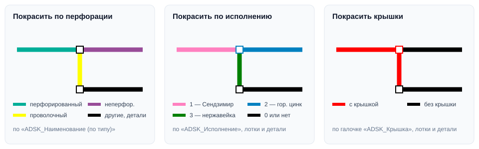

# Кабельные лотки

## Введение

Набор команд для кабельных лотков: заполнение артикулов и наименований для спецификации и три режима раскраски лотков на виде для проверки модели. Все команды — в выпадающей кнопке **Кабельные лотки** на вкладке **ToadTools**, панель **Лотки**.

| Команда | Что делает |
|---|---|
| [Артикулы и наименования](#артикулы-и-наименования) | Заполняет код изделия, наименование и количество у лотков |
| [Покрасить по перфорации](#покраска) | Раскрашивает лотки на активном виде по типу: перфорированный, неперфорированный, проволочный |
| [Покрасить по исполнению](#покраска) | Раскрашивает лотки и детали по исполнению (покрытию) |
| [Покрасить крышки](#покраска) | Выделяет красным лотки и детали с крышкой |

Каждая команда идёт одной операцией: во время работы показывается прогресс, «Прервать» откатывает изменения, а после завершения всё отменяется одним **Ctrl+Z**. В конце появляется итог с количеством обработанных лотков и замечаниями (первые 15 элементов с ID).

## Артикулы и наименования

Обрабатывает **выделенные лотки**, а если ничего не выделено — **все лотки модели**.

Для каждого лотка плагин берёт тип из параметра типа **ADSK_Наименование (по типу)**, размер (высота × ширина) и **ADSK_Исполнение**, находит артикул в таблице производителя и заполняет:

| Параметр | Что записывается |
|---|---|
| **ADSK_Код изделия** | Артикул по таблице + суффикс исполнения |
| **ADSK_Наименование** | Тип, размер и исполнение |
| **ADSK_Количество** | Длина лотка в метрах, с точностью до 0,1 |

| ADSK_Исполнение | Суффикс артикула | Окончание наименования |
|---|---|---|
| 1 | — | «…, оцинковка горячим способом по методу Сендзимира» |
| 2 | `HDZ` | «…, горячего цинкования» |
| 3 | `INOX` | «…, из нержавеющей стали» |
| 0 | — | Код и наименование **не трогаются** — заполните вручную (в наименование запишется подсказка) |

Например, перфорированный лоток 100×50 с исполнением 2 получит код `35262HDZ` и наименование «Лоток перфорированный 100x50, горячего цинкования».

Поддерживаемые типы (значение **ADSK_Наименование (по типу)**): *Лоток неперфорированный*, *Лоток перфорированный*, *Лоток лестничный*, *Лоток проволочный* — высота 50, 80 или 100 мм, ширина до 600 мм.

> [!WARNING]
> Если для размера нет артикула, в код записывается **«ЗНАЧЕНИЕ НЕ НАЙДЕНО»**, а в наименование — просьба поправить. Если тип не распознан, код и наименование **очищаются**. Такие лотки перечислены в итоговом окне.

> [!NOTE]
> Лотки, у которых нет нужных параметров (ADSK_Исполнение, ADSK_Код изделия, ADSK_Наименование, ADSK_Количество), пропускаются и тоже попадают в итог.

## Покраска

Команды покраски переопределяют графику лотков и соединительных деталей **на активном виде** (план, разрез или 3D). Модель не меняется — меняется только вид.

| Команда | Цвет | По какому параметру |
|---|---|---|
| **Покрасить по перфорации** | 🟩 перфорированный, 🟪 неперфорированный, 🟨 проволочный, ⬛ остальные; детали — чёрные | ADSK_Наименование (по типу) |
| **Покрасить по исполнению** | 🩷 1 — Сендзимир, 🟦 2 — горячее цинкование, 🟩 3 — нержавеющая сталь, ⬛ 0 или нет параметра | ADSK_Исполнение — у лотков и у деталей |
| **Покрасить крышки** | 🟥 с крышкой, ⬛ без крышки | ADSK_Крышка — у лотков и у деталей |

> [!TIP]
> Чтобы вернуть обычный вид, выделите лотки и сбросьте переопределения: правый щелчок → **Переопределить графику на виде → По элементу → Сбросить**. Или раскрашивайте на отдельном рабочем виде.

## Если что-то пошло не так

| Проблема | Что делать |
|---|---|
| «В модели нет кабельных лотков» | В модели или выделении нет лотков категории «Кабельные лотки» |
| «На виде … нельзя переопределять графику» | Откройте план, разрез или 3D-вид (не лист и не спецификацию) |
| Код «ЗНАЧЕНИЕ НЕ НАЙДЕНО» | Для этого размера нет артикула в таблице — проверьте размер или заполните вручную |
| Код и наименование пропали | Не заполнен или написан иначе «ADSK_Наименование (по типу)» у типа лотка |
| Все лотки чёрные | Не заполнены параметры, по которым идёт покраска |
