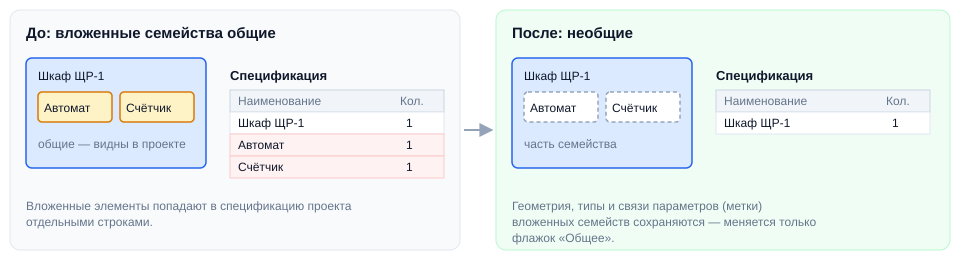

# Заменить общие семейства необщими

## Введение

Инструмент делает все **общие вложенные семейства** текущего семейства **необщими**. Так вложенные элементы перестают попадать в спецификации проекта отдельными строками, а всё остальное в семействе остаётся как было.

Запуск — **Общие → необщие** на вкладке **ToadTools**, панель **BIM**.

> [!WARNING]
> Работает только в **редакторе семейства**. В проекте плагин покажет ошибку «Эту команду надо запускать в редакторе семейства, а не в проекте».

## Как пользоваться

1. Откройте семейство в редакторе (**Изменить семейство**).
2. Нажмите **Общие → необщие**. Пока идёт замена, показывается прогресс; «Прервать» остановит замену после текущего семейства — уже заменённые останутся необщими.
3. В итоговом окне — сколько вложенных семейств заменено, их имена и ошибки, если были.
4. Загрузите семейство обратно в проект.

> [!NOTE]
> Если параметры вложенных экземпляров были связаны с параметрами основного семейства (метки), плагин восстановит эти связи. Меняется только флажок «Общее» — геометрия, типы и размещение остаются прежними.

## Если что-то пошло не так

| Проблема | Что делать |
|---|---|
| «Ничего не найдено» | В семействе нет общих вложенных семейств — делать ничего не нужно |
| «Текущее семейство открыто только для чтения» | Откройте семейство с возможностью редактирования |
| «Не удалось восстановить метку параметра…» | Свяжите этот параметр вложенного экземпляра с параметром семейства вручную (кнопка рядом с параметром в свойствах) |
