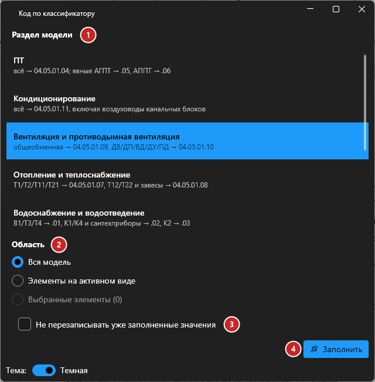
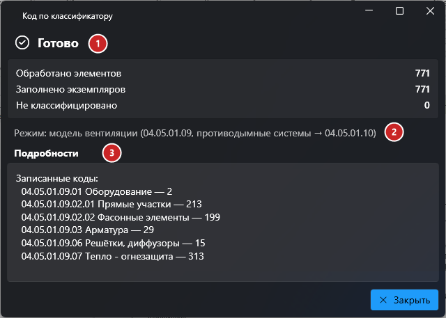

# Код по классификатору

## Введение

Плагин заполняет параметры **«ADSK_Код по классификатору»** и **«ADSK_Описание по классификатору»** у элементов инженерных систем по классификатору «Пионер. Донской»: ВК, ПТ, ОВ, кондиционирование, ЭОМ и СС.

Код подбирается по разделу модели, системе элемента, его категории и наименованию (ADSK_Наименование, семейство, типоразмер, марка).

Запуск — **Код классификатора** на вкладке **ToadTools**, панель **Общие**.

## Окно плагина

1. **Раздел модели**. Если в имени файла есть шифр раздела (ПТ, ОВВ, ОВО, КНД, ВК, ЭОМ, СС…), раздел выбирается автоматически и рядом пишется «(определён по имени файла)». Под каждым разделом — подсказка, какие коды он ставит:

   | Раздел | Как распределяются коды |
   |---|---|
   | ПТ | всё → 04.05.01.04; явные АГПТ → .05, АППТ → .06 |
   | Кондиционирование | всё → 04.05.01.11, включая воздуховоды канальных блоков |
   | Вентиляция и противодымная вентиляция | общеобменная → 04.05.01.09, ДВ/ДП/ВД/ДУ/ПД → 04.05.01.10 |
   | Отопление и теплоснабжение | Т1/Т2/Т11/Т21 → 04.05.01.07, Т12/Т22 и завесы → 04.05.01.08 |
   | Водоснабжение и водоотведение | В1/Т3/Т4 → .01, К1/К4 и сантехприборы → .02, К2 → .03 |
   | ЭОМ | всё → 04.05.02; задания на отверстия не заполняются |
   | СС | 04.05.03.XX по шифру комплекта или рабочему набору (АУПС, СОУЭ, СКУД...) |

2. **Область**: вся модель, элементы на активном виде или выбранные элементы (если перед запуском что-то выделено, этот вариант выбран по умолчанию).
3. **Не перезаписывать уже заполненные значения** — элементы, у которых код уже есть, останутся как были.
4. **Заполнить** — запускает заполнение. Во время работы показывается прогресс; «Прервать» откатывает изменения.

## Отчёт

1. **Итог** — сколько элементов обработано, сколько экземпляров заполнено и сколько не удалось классифицировать.
2. **Режим** — по какому разделу считались коды.
3. **Подробности** — какие коды записаны и сколько раз, какие параметры добавлены в проект, что не классифицировано и почему.

Если есть необработанные элементы, появится кнопка **«Выделить необработанные»** — она выделит их в модели.

## Категории

Плагин обрабатывает элементы только этих категорий:

- **Трубопроводы:** трубы, гибкие трубы, соединительные детали и арматура трубопроводов, материалы изоляции труб, сантехнические приборы, спринклеры;
- **Воздуховоды:** воздуховоды, гибкие воздуховоды, соединительные детали и арматура воздуховодов, воздухораспределители, материалы изоляции воздуховодов;
- **Оборудование:** оборудование, электрооборудование, шкафы (Casework);
- **Кабеленесущие системы:** кабельные лотки и их соединительные детали, короба и их соединительные детали;
- **Электрика и освещение:** электрические приборы, осветительные приборы, выключатели (Lighting Devices);
- **Слаботочные системы:** пожарная сигнализация, охранная сигнализация, вызов медсестры, телефонные устройства, устройства связи.

> [!NOTE]
> Если в проекте нет параметров классификатора, плагин добавит их сам из файла общих параметров (ФОП), подключённого к Revit. Если в подключённом ФОП их нет, плагин предложит выбрать другой ФОП. Ваша настройка ФОП после этого вернётся обратно.
>
> Если параметры уже есть, но привязаны не ко всем категориям из списка, плагин добавит недостающие категории к их привязке (тип привязки и уже привязанные категории сохраняются). Что именно добавлено, видно в отчёте.

> [!TIP]
> Если параметр типовой, код записывается в тип — но только когда все экземпляры типа получили одинаковый код. Иначе тип попадёт в отчёт в раздел «Типы с разными кодами у экземпляров».

> [!WARNING]
> В СС подсистемы АГПТ и СКЗ, а также аксессуары телекоммуникационных шкафов заполняются вручную — плагин их пропускает.

## Если что-то пошло не так

| Проблема | Что делать |
|---|---|
| Раздел выбран неправильно | Выберите нужный раздел в списке вручную — автоопределение работает только по шифру в имени файла |
| Много «Не классифицировано» | Посмотрите причины в «Подробностях»: чаще всего не заполнены система или ADSK_Наименование |
| Плагин просит выбрать ФОП | В подключённом к Revit файле общих параметров нет параметров классификатора — укажите ФОП, где они есть |
| Тип попал в «Типы с разными кодами у экземпляров» | Экземпляры одного типа получили разные коды (например, разные системы) — код в тип не записан, разделите типы или сделайте параметр экземплярным |
