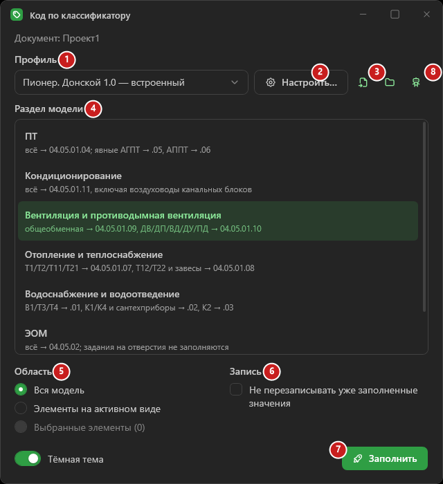
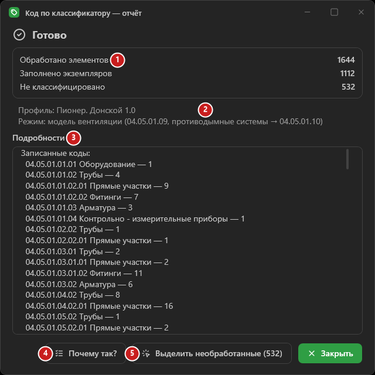
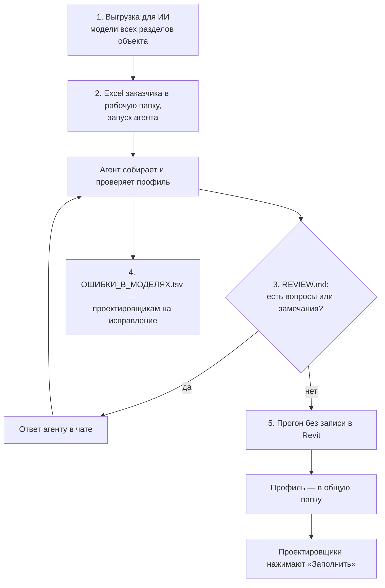
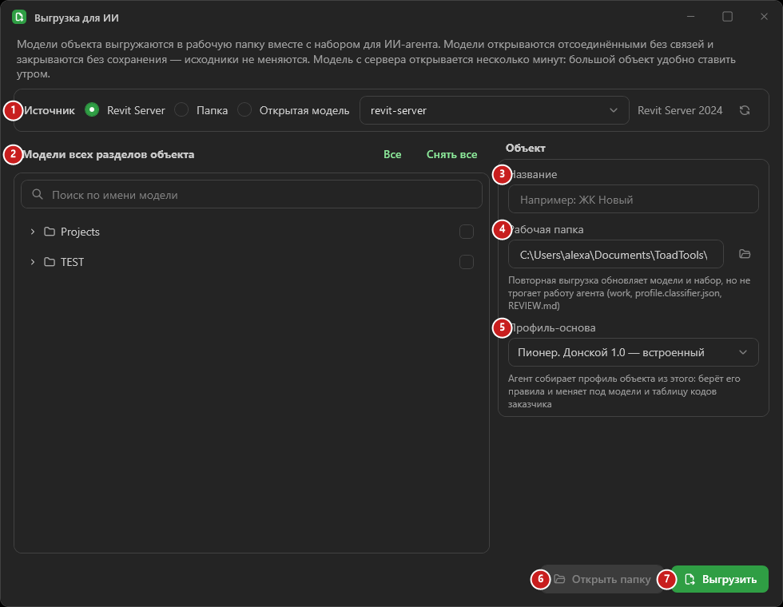
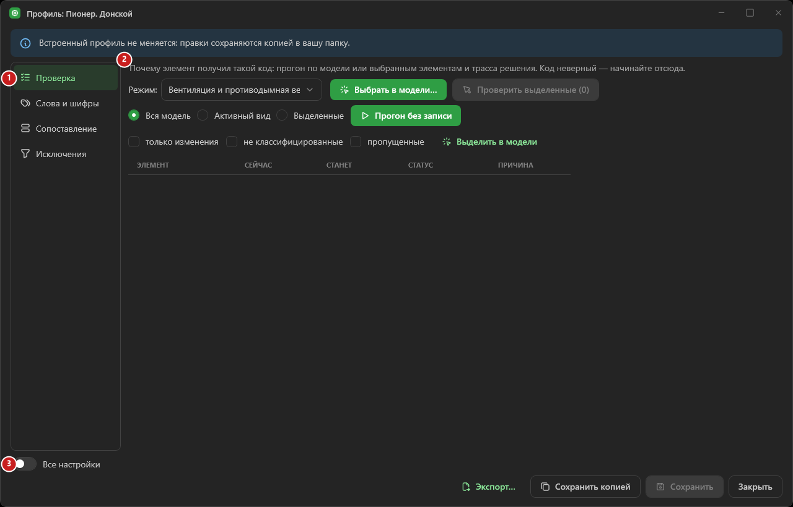
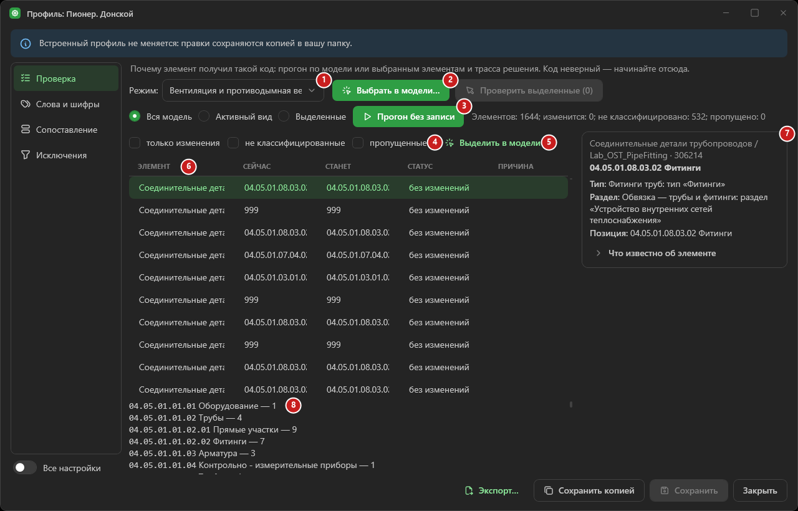
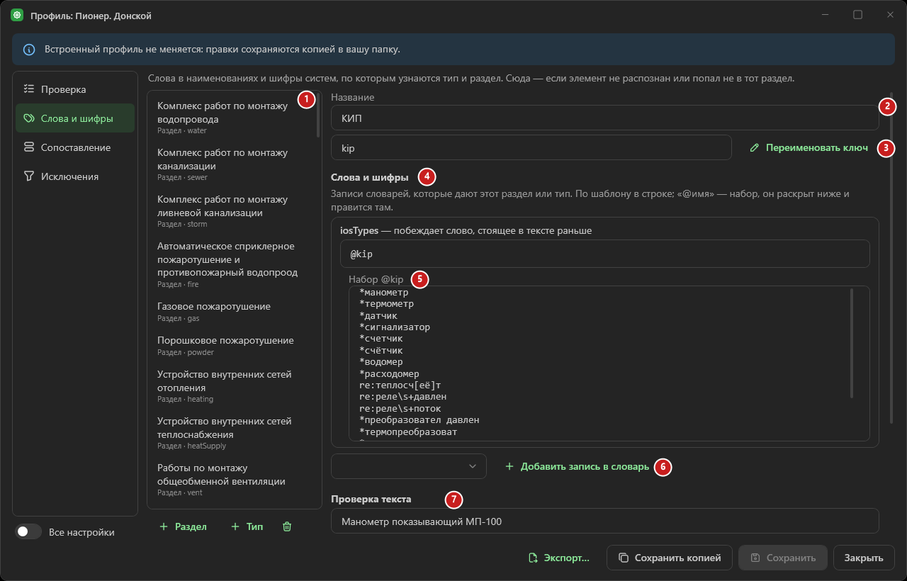
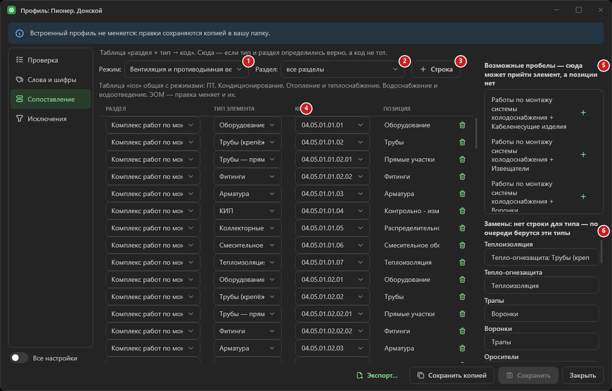
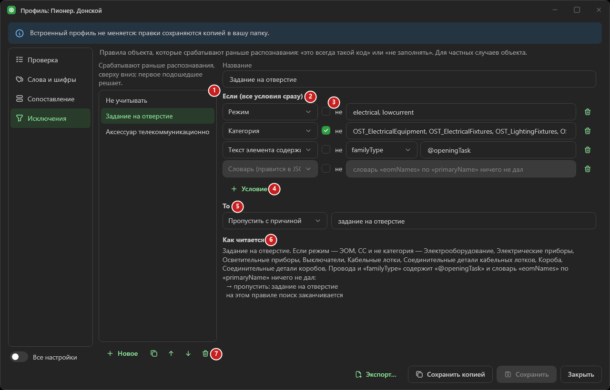

# Код по классификатору

## Введение

Заказчик принимает модель с кодами: у каждой трубы, решётки и щита должен стоять код позиции из его классификатора. Вручную это тысячи элементов на модель. Плагин проходит по модели и сам записывает каждому элементу инженерных систем **код** и **описание** — ВК, ПТ, ОВ, кондиционирование, ЭОМ, СС.

Как он решает, какой код поставить: определяет у элемента **тип** (труба, арматура, КИП, решётка…) и **раздел** (водопровод, канализация, противодымная вентиляция…). Пара «раздел + тип» — это строка классификатора.

| Элемент в модели | Тип | Раздел | Что запишется |
|---|---|---|---|
| Труба в системе В1 | Трубы — прямые участки | Водопровод | `04.05.01.01.02.01` Прямые участки |
| «Манометр показывающий» в системе В1 | КИП | Водопровод | `04.05.01.01.04` Контрольно - измерительные приборы |
| Воздуховод в системе ДВ1 | Воздуховоды — прямые участки | Противодымная вентиляция | `04.05.01.10.02.01` Прямые участки |

Примеры — по встроенному профилю «Пионер. Донской». Код пишется в параметр `ADSK_Код по классификатору`, описание — в `ADSK_Описание по классификатору`.

Тип плагин узнаёт по словам в наименовании и по категории, раздел — по шифру системы, а в СС — по шифру комплекта или рабочему набору. Все эти слова, шифры, сам классификатор и параметры для записи лежат не в плагине, а в **профиле** — файле настроек объекта. У каждого объекта свой профиль: у ЖК с другим заказчиком другие коды и другие имена систем.

Запуск — кнопка **Код классификатора** на вкладке **ToadTools**, панель **Общие**.

## Кому что читать

| Вы | Что вам нужно | Куда идти |
|---|---|---|
| **Проектировщик** | Выбрать профиль и раздел, нажать **Заполнить**, разобраться с тем, что не заполнилось | [Заполнить коды в модели](#заполнить-коды-в-модели) — этого раздела достаточно |
| **Координатор**, новый объект | Собрать профиль объекта с ИИ-агентом и раздать его отделу | [Профиль нового объекта с ИИ](#профиль-нового-объекта-с-ии) |
| **Координатор**, правка | Поправить слово, шифр или код в готовом профиле | [Редактор профиля](#редактор-профиля) |

Проектировщику не нужны ни ИИ, ни редактор: профиль ему даёт координатор.

## Заполнить коды в модели

1. Откройте модель. Если заполнить нужно только часть — выделите элементы.
2. Нажмите **Код классификатора**.
3. Проверьте **профиль** (ваш объект) и **раздел модели** — обычно они уже выбраны правильно.
4. Нажмите **Заполнить** и посмотрите отчёт.

Запускать можно сколько угодно раз: поменяли систему у элемента, домоделировали этаж — заполните ещё раз, коды обновятся.

### Окно запуска

1. **Профиль** — по какому профилю заполнять. При открытии окно выбирает его само:
   - профиль, которым эта модель заполнялась в прошлый раз (модель его помнит);
   - иначе — профиль, под шаблон имени файла которого подходит имя модели;
   - иначе — тот, которым вы заполняли в последний раз, а если такого нет — встроенный.
2. **Настроить…** — редактор выбранного профиля (см. [Редактор профиля](#редактор-профиля)). Проектировщику обычно не нужен.
3. **Импорт профиля** из файла и **общие папки профилей**. Координатор кладёт профиль объекта в сетевую папку — добавьте её здесь один раз, и профили из неё появятся в списке (с пометкой «— общий»).
4. **Раздел модели** — что это за модель: ВК, вентиляция, отопление… От раздела зависит, как читаются системы. Под названием раздела написано, какие коды он даёт.
5. **Область** — вся модель, элементы на активном виде или выбранные элементы. Если перед запуском что-то выделено, выбран третий вариант.
6. **Запись → Не перезаписывать уже заполненные значения** — элементы, у которых код уже стоит, останутся как были. Включайте, если часть кодов правили руками.
7. **Заполнить** — запускает заполнение. Идёт окно прогресса; **Прервать** откатывает всё, что успело записаться.
8. **Выгрузка для ИИ** (робот) — инструмент координатора, проектировщикам не нужен (см. [Профиль нового объекта с ИИ](#профиль-нового-объекта-с-ии)).

Раздел модели окно тоже выбирает само, в таком порядке:

- раздел, которым модель заполнялась в прошлый раз;
- иначе — по шифру в имени файла: имя режется по дефисам, подчёркиваниям, точкам и пробелам, шифр ищется с конца. `ШФТ-СОБ-1-ПТ` → ПТ. Рядом с заголовком появляется «— определён по имени файла»;
- иначе — просто первый раздел в списке.

> [!WARNING]
> Если шифра в имени файла нет (или он не из списка — например, просто `ОВ` вместо `ОВВ` / `ОВО`), выбран **первый раздел списка**, и это почти наверняка не ваш. Модель вентиляции, заполненная как «ПТ», получит коды пожаротушения. Взгляните на раздел перед тем, как нажать **Заполнить**.

> [!IMPORTANT]
> Если в профиле есть ошибки, кнопка **Заполнить** недоступна, а под профилем появляется ссылка **«Ошибок в профиле: N — открыть»** — она открывает редактор на месте первой ошибки. Это сделано нарочно: с битым профилем половина модели молча ушла бы в «не классифицировано». Проектировщику — сообщить координатору.

Сверху окна может появиться жёлтое предупреждение:

| Предупреждение | Что это значит |
|---|---|
| «Модель заполнялась профилем «…», его нет в библиотеке — выбран другой» | Коллега заполнял модель профилем, которого у вас нет. Добавьте общую папку профилей (кнопка с папкой) или импортируйте файл профиля — иначе заполните модель чужими кодами |
| «Модель заполнялась версией 1.0 профиля «…», сейчас выбрана 1.1» | Профиль обновили. Это нормально: заполните заново, коды пересчитаются по новой версии |
| «Модель заполнялась разделом «…», в этой версии профиля его нет — выберите раздел вручную» | Раздел не выбран, **Заполнить** недоступна, пока вы не выберете раздел сами |

### Отчёт

1. **Итог** — сколько элементов обработано и сколько заполнено. Ниже — строки, которые появляются только если есть что показать:

   | Строка | Что значит |
   |---|---|
   | Заполнено типов | код записан в тип, потому что параметр кода в проекте типовой |
   | Пропущено (уже заполнено) | сработала галочка «Не перезаписывать» |
   | Пропущено (*причина*) | профиль велел не заполнять: задание на отверстие, подсистема заполняется вручную… |
   | Не классифицировано | плагин не смог подобрать код — см. [ниже](#почему-элемент-не-получил-код) |
   | Нет параметров для записи | у элемента нет параметра кода ни в экземпляре, ни в типе |
   | Заняты другими пользователями | элемент взят коллегой — в модели из хранилища такие не трогаются |
   | Типы с разными кодами у экземпляров | параметр типовой, а экземпляры одного типа получили разные коды — тип не заполнен |
   | Ошибки записи | Revit не дал записать значение (параметр только для чтения или не текстовый) |

2. **Профиль и режим** — по какому профилю и разделу считались коды. Сверьте, если цифры выглядят странно.
3. **Подробности** — какие коды записаны и сколько раз; какие параметры и категории плагин добавил в проект; группы не классифицированных в виде «категория / семейство: причина» (до 40 самых крупных).
4. **Почему так?** — открывает [Проверку](#проверка) в редакторе профиля с необработанными элементами (первые 50): у каждого видно, на каком шаге он «потерялся».
5. **Выделить необработанные** — закрывает отчёт и выделяет в модели всё, что не заполнилось: не классифицированные, без параметров, с ошибкой записи.

Кнопки 4 и 5 есть, только когда необработанные элементы остались.

### Почему элемент не получил код

У каждого не классифицированного элемента в отчёте написана причина. Чаще всего дело в модели, а не в профиле:

| Причина в отчёте | Что произошло | Что делать |
|---|---|---|
| не определён тип элемента | В наименовании нет слова, которое профиль знает | Заполните `ADSK_Наименование` понятным словом («Клапан обратный», а не «КО-25»). Наименование правильное — напишите координатору, он добавит слово в профиль |
| не определён раздел | Плагин не понял, к какой системе относится элемент | Подключите элемент к системе или заполните имя системы. В СС — шифр комплекта или рабочий набор |
| нет позиции для «*раздел*» + «*тип*» | Тип и раздел определились, но такой строки в классификаторе нет | Обычно элемент не в той системе — радиатор в канализации. Если всё верно — координатору: в профиле не хватает строки |

Во встроенном профиле наименование читается из `ADSK_Наименование`, имени семейства и типа и `ADSK_Марка`; система — из систем Revit и параметров `ADSK_Имя системы`, `ADSK_Система`, `ADSK_Группирование`; шифр комплекта СС — из `ADSK_Штамп_Шифр комплекта`. В профиле другого объекта параметры могут быть другими.

> [!TIP]
> Не гадайте — нажмите **Почему так?**. Справа от таблицы будет трасса: какой текст плагин прочитал у элемента, какое слово в нём нашёл и на чём остановился.

## Профиль нового объекта с ИИ

*Раздел для координатора.*

В профиле сотни настроек: вся таблица кодов заказчика, слова для каждого типа, шифры всех систем объекта. Вручную это неделя работы и гарантированные пропуски. Поэтому профиль собирает ИИ-агент — [Claude Code](https://claude.com/claude-code) или Codex. Вы выгружаете из Revit модели объекта и кладёте рядом Excel заказчика; агент сам читает таблицу, смотрит, какие системы и наименования есть в моделях, пишет профиль, проверяет его тем же движком, что работает в плагине, и пишет вам отчёт.

Ваша часть — прочитать отчёт, ответить на вопросы и раздать профиль. Обычно это один-два раза за проект: когда модели уже наполнены (есть системы, семейства, наименования) и ближе к выдаче, когда они дополнились.

### Шаг 1. Выгрузка для ИИ

**Код классификатора** → кнопка с роботом в ряду рядом с профилем.

1. **Источник** — откуда брать модели:
   - **Revit Server** (по умолчанию) — список серверов берётся из `RSN.ini` той версии Revit, в которой вы работаете; имя сервера можно вписать руками;
   - **Папка** с файлами `.rvt`;
   - **Открытая модель** — только та, что открыта сейчас.
2. **Модели** — отметьте модели **всех разделов** объекта: ВК, ОВ, ПТ, ЭОМ, СС. Агент видит только то, что вы выгрузили: забыли модель СС — в профиле не будет слаботочки. Поиск и галочки работают как в [ToadExporter](ToadExporter).
3. **Название** объекта — например, «ЖК Новый». Из него получается имя рабочей папки.
4. **Рабочая папка** — по умолчанию `Документы\ToadTools\Классификатор\<объект>`. Здесь будет жить вся работа над профилем объекта.
5. **Профиль-основа** — из чего агент собирает профиль. Для нового объекта — «Пионер. Донской» или профиль похожего объекта: агент возьмёт оттуда знание «манометр — это КИП» и поменяет коды и шифры. Для доработки — ранее собранный профиль этого же объекта.
6. **Открыть папку** — рабочая папка последней выгрузки (кнопка активна после выгрузки).
7. **Выгрузить** — модели открываются по одной. В окне прогресса есть **Пропустить модель** и **Прервать**.

Что происходит с моделями: каждая открывается **отсоединённо, без связей** и закрывается **без сохранения**. На сервере и в исходных файлах ничего не меняется. Ошибка одной модели не останавливает остальные — в конце будет сводка «выгружено / пропущено / с ошибкой», а причина записана в `exports\_журнал.txt`.

> [!NOTE]
> Модель с сервера открывается несколько минут, а Revit на время выгрузки занят. Большой объект удобно поставить на выгрузку утром или перед обедом.

> [!WARNING]
> Модель, у файла которой стоит атрибут «Только чтение», сейчас не выгружается — падает с ошибкой «Failed to transmit TransmissionData». Снимите атрибут в свойствах файла и выгрузите её ещё раз.

Что появляется в рабочей папке:

| Путь | Что это |
|---|---|
| `README_КООРДИНАТОРУ.txt` | короткая памятка, что делать дальше |
| `AGENTS.md`, `CLAUDE.md` | задание агенту. Текст — в `AGENTS.md` (его читает Codex), `CLAUDE.md` подключает его для Claude Code. Что допишете в `CLAUDE.md`, повторная выгрузка не сотрёт |
| `exports\*.export.json` | выгрузки, по файлу на модель: элементы инженерных категорий со всеми заполненными параметрами, системами, рабочими наборами и кодами, которые уже стоят |
| `exports\_журнал.txt` | журнал выгрузки: что выгружено, за сколько, какие ошибки |
| `kit\` | формат профиля, профиль-основа и проверялка `check.exe` — менять не нужно |

Файлы выгрузок большие — в них каждый параметр каждого элемента. Открывать их самому незачем.

Повторная выгрузка обновляет `exports\` и `kit\`, но **не трогает работу агента**: `work\`, `profile.classifier.json`, `REVIEW.md`. Модели дополнились — выгрузите их снова в ту же папку и попросите агента прогнать профиль заново.

### Шаг 2. Агент

1. Положите в рабочую папку таблицу кодов заказчика (`.xlsx`).
2. Откройте в этой папке Claude Code (или Codex) и напишите:

   > Собери профиль классификатора для объекта по CLAUDE.md. Таблица кодов — Классификатор.xlsx.

3. Дальше агент работает сам: читает таблицу, составляет сводку по моделям (какие семейства, наименования, системы, рабочие наборы), правит копию профиля-основы и гоняет её проверялкой, пока без кода не останутся только объяснимые элементы.

Чего от агента ждать:

- **Коды — только из таблицы заказчика.** Позицию, которой нет в Excel, он не выдумает.
- **Шифры систем и слова — из моделей**, а не «как обычно бывает».
- Если в Excel несколько листов или неясно, какая ветка кодов нужна, — он **спросит**. Листы с укрупнёнными или бюджетными статьями не подходят, нужен лист с полными кодами инженерных систем.
- Если модели уже заполнялись профилем, который есть у вас в библиотеке, агент увидит коды, **исправленные руками**, и разберётся, почему профиль дал другое.

Результат — три файла в рабочей папке: `profile.classifier.json`, `REVIEW.md` и `ОШИБКИ_В_МОДЕЛЯХ.tsv`.

### Шаг 3. Отчёт REVIEW.md

Это главное, что вы читаете. Профиль целиком смотреть не нужно.

| Раздел отчёта | На что смотреть |
|---|---|
| Итог | Все ли модели на месте и верно ли определён раздел каждой; сколько элементов получат код; какой лист и ветка таблицы взяты |
| По кодам | У каждого кода — 3–5 самых частых наименований. Читайте глазами: огнетушитель в «Арматуре» или кран в «КИП» видно сразу |
| Спорное | Что агент отнёс по догадке, с вариантами. Выберите вариант |
| Не классифицировано | Группы без кода и почему это нормально (задания на отверстия, «не учитывать») или что нужно от вас |
| Ошибки в моделях | Сколько элементов стоит не в той системе или не в том рабочем наборе |
| Вопросы координатору | На что нужен ваш ответ |

Отвечайте агенту прямо в чате, обычными словами: «огнетушители — в оборудование ПТ», «на вопрос 2 — вариант Б». Он поправит профиль, прогонит его по всем моделям и обновит отчёт. Круг повторяется, пока отчёт вас не устроит.

> [!NOTE]
> Позиции классификатора, которых нет в моделях (пусконаладка, ПО, работы), — это нормально. В отчёте они перечислены отдельной строкой.

### Шаг 4. Ошибки в моделях

Проектировщики ошибаются: один радиатор из двухсот подключён к системе теплоснабжения, пять извещателей лежат в чужом рабочем наборе. Подгонять профиль под такие элементы нельзя — получится правило ради ошибки. Поэтому агент **решает по большинству**, а выбросы выписывает в `ОШИБКИ_В_МОДЕЛЯХ.tsv`.

Как ищутся выбросы: берётся группа одинаковых элементов (одно семейство, тип и наименование), в ней не меньше пяти штук. Если почти все они в одном разделе или рабочем наборе, а немногие — не больше 5 % и не больше 10 штук — в другом, это кандидаты в ошибки. Агент оставляет в файле только подтверждённые.

Файл открывается в Excel. Колонки: модель, Id, элемент, что сейчас, что ожидается, что исправить. Отдайте его проектировщикам — по Id элемент находится в Revit командой «Выбор по коду».

> [!TIP]
> После исправления в модели править профиль не нужно: при следующем **Заполнить** элементы сами получат верный код.

### Шаг 5. Профиль — в работу

1. **Код классификатора** → **Импорт профиля** (кнопка рядом с «Настроить…») → `profile.classifier.json` из рабочей папки. Профиль скопируется в вашу личную папку и выберется в списке. Если вы импортируете доработанную версию того же профиля, окно спросит, заменить ли прежнюю, — отвечайте «Да».
2. Откройте одну-две модели объекта → **Настроить…** → [Проверка](#проверка) → **Прогон без записи**. Пробегитесь глазами: коды те, что ожидаете, не классифицированных столько же, сколько в отчёте.
3. Положите `profile.classifier.json` в общую папку профилей отдела. Проектировщики, у которых эта папка добавлена в окне запуска, увидят профиль при следующем открытии окна.

> [!NOTE]
> У вас в списке профиль теперь значится дважды: ваш личный и «— общий». Это один и тот же профиль, моделям всё равно, каким из них заполнять.

> [!TIP]
> Мелкую правку — одно слово, один код — быстрее сделать самому в [редакторе](#редактор-профиля). Крупную (новая система, новый лист классификатора, полсотни не классифицированных) лучше отдать агенту: он прогонит профиль по всем моделям объекта и заметит, если правка сломала соседнее.

## Где лежат профили

Профиль — один файл `*.classifier.json`. Плагин собирает список профилей из трёх мест:

| Где | Что там | Можно менять |
|---|---|---|
| Внутри плагина | Встроенный «Пионер. Донской» | Нет. Правки сохраняются **копией** в личную папку |
| Личная папка `%AppData%\ToadTools\ClassifierCode\Profiles` | Всё, что вы импортировали и сохранили | Да |
| Общие папки (кнопка с папкой в окне запуска) | Профили отдела, обычно сетевая папка | Да, если в папку можно писать. Иначе профиль помечен «— общий, только чтение» и сохраняется копией |

Что полезно знать про хранение:

- **В модели лежит только ссылка** на профиль: название, версия и раздел. Сам профиль в модель не попадает. Поэтому профиль объекта и держат в сетевой папке: коллега открывает модель — плагин находит тот же профиль и тот же раздел.
- **Перед перезаписью** рядом с файлом остаётся прежняя версия с расширением `.bak`.
- **Двое правят один файл.** Если коллега сохранил профиль в общей папке, пока он был открыт у вас, ваше сохранение не пройдёт — сохраните копией или откройте профиль заново. Молча чужая правка не затрётся.
- Профиль, сделанный в **более новой версии плагина**, не перезаписывается — обновите ToadTools.
- Файл, который не удалось прочитать, виден в списке как «имя файла — не читается» и остальным профилям не мешает.

## Редактор профиля

*Раздел для координатора.*

Открывается кнопкой **Настроить…**. Профиль собирает агент, а редактор нужен для двух вещей: **посмотреть, почему элемент получил такой код**, и **поправить по мелочи**.

1. **Вкладки** — по умолчанию четыре: **Проверка** (открывается первой), **Слова и шифры**, **Сопоставление**, **Исключения**. Этого хватает для девяти правок из десяти.
2. **Подсказка** — что делают на вкладке и когда сюда идти.
3. **Все настройки** — показывает ещё четыре вкладки: **Общее**, **Классификатор**, **Режимы** и **Логика**. Выбор запоминается.

Внизу окна — список ошибок профиля (щелчок по ошибке ведёт к её месту, даже если вкладка скрыта) и кнопки **Экспорт…**, **Сохранить копией**, **Сохранить**.

Профиль пересобирается после каждой правки, и **Проверка** сразу считает по-новому — сохранять для этого не нужно. Можно править и смотреть результат, а сохранить в конце. При закрытии с несохранёнными правками окно спросит.

### Нашли неверный код — что делать

1. **Проверка** → **Выбрать в модели…** → щёлкните элемент → **Готово**. В трассе справа видно, по какому слову и шифру он получил тип и раздел.
2. Идите на вкладку по тому, что неверно:

   | Что не так | Куда | Что сделать |
   |---|---|---|
   | Не тот **тип** или тип не определён («Тахометр» не стал КИП) | Слова и шифры | Добавить слово в набор типа |
   | Не тот **раздел** (система Т5 не распознана как отопление) | Слова и шифры | Добавить шифр системы разделу |
   | Тип и раздел верные, а **код** не тот | Сопоставление | Поменять код в строке или добавить строку |
   | Особый случай объекта («всё с ГОСТ в марке не заполнять») | Исключения | Добавить правило |

3. **Проверка** → **Прогон без записи** → фильтр **только изменения**: что поменяется по всей модели. Убедитесь, что правка не задела лишнего.
4. **Сохранить** (для встроенного и «только чтение» — **Сохранить копией**).

### Проверка

1. **Режим** — по какому разделу модели считать. Из окна запуска подставляется выбранный там раздел.
2. **Выбрать в модели…** — окна плагина свернутся; выберите элементы в Revit и нажмите **Готово** на панели параметров (Esc — отмена). Рядом — **Проверить выделенные**: элементы, выделенные до запуска плагина. За раз показывается до 50 элементов.
3. **Прогон без записи** — по всей модели, активному виду или выделенным: что получит каждый элемент. В модель ничего не пишется. Рядом — итог: сколько элементов, сколько изменится, не классифицировано, пропущено.
4. **Фильтры** — только изменения, не классифицированные, пропущенные.
5. **Выделить в модели** — выделит показанные в таблице элементы (увидите после закрытия окон).
6. **Таблица** — элемент, код сейчас, код станет, статус, причина. Щелчок по строке показывает подробности справа.
7. **Трасса** — как получен код, по шагам: исключения → тип → раздел → позиция. У каждого шага — какой текст прочитан, какой шаблон сработал, что вышло. Ниже раскрывается **Что известно об элементе**: категория, семейство и тип, системы, рабочий набор, родительское семейство и все тексты, которые читает профиль.
8. **Итог по кодам** — сколько элементов получит каждый код.

> [!NOTE]
> Прогон берёт только элементы, у которых уже есть параметр кода. В модели, где плагин ещё ни разу не запускали и параметров нет, прогон будет пустым — параметры добавляются при первом **Заполнить**.

### Слова и шифры

Здесь правится то, по чему профиль узнаёт тип и раздел.

1. **Разделы и типы профиля** — выберите, что править. Кнопки внизу: добавить раздел, добавить тип, удалить. Если удаляемое где-то используется, окно сначала покажет, где.
2. **Название** — так раздел или тип видят люди: в отчёте, в трассе, в таблице сопоставления.
3. **Переименовать ключ** — ключ (внутреннее имя латиницей) меняется сразу во всём профиле: в таблице, словарях, правилах, исключениях.
4. **Слова и шифры** — все записи словарей, которые дают этот раздел или тип. У каждого словаря написано, как он выбирает из нескольких совпадений: «побеждает слово, стоящее в тексте раньше», «первая подходящая запись по порядку» или «точный шифр, ищется с конца текста».
5. **Набор** — запись вида `@kip` означает «все шаблоны набора kip». Набор раскрыт тут же и правится на месте, по шаблону в строке. Чтобы «Тахометр» стал КИП, допишите в набор строку `тахометр`.
6. **Добавить запись в словарь** — если раздел или тип ещё не упомянут в нужном словаре.
7. **Проверка текста** — вставьте наименование или имя системы и увидите, какие шаблоны совпали и в каком месте. Проверяйте каждое новое слово здесь же.

Как пишутся шаблоны:

| Шаблон | Что значит |
|---|---|
| `трап` | с начала слова: «Трапы», но не «атрап» (`трап*` — то же самое) |
| `*изоляц` | где угодно, в том числе внутри слова: «Теплоизоляция» |
| `=пк` | слово целиком |
| `шкаф пожарн` | слова подряд, у каждого кроме последнего допускается окончание: «Шкафы пожарные» |
| `#В1` | шифр системы: перед ним не буква, после не цифра — В1, 1В1, В1.1, но не ПВ1 и не В11 |
| `#!В1` | то же, но перед шифром не может быть и цифры: не 1В1 |
| `@набор` | все шаблоны набора |
| `re:…` | регулярное выражение как есть |

> [!TIP]
> Регистр не важен. В именах систем латинские буквы-двойники приводятся к кириллице, так что `B1`, набранная латиницей, найдётся как В1. Во встроенном профиле много слов со звёздочкой впереди (`*манометр`) и шифров через `re:` — так они в точности повторяют логику прежних версий плагина. В новых записях достаточно простых форм: `тахометр`, `#Т5`.

### Сопоставление

Таблица «раздел + тип → код». Сюда идут, когда элемент распознан верно, а код не тот или его нет.

1. **Режим** — таблицу какого раздела модели править. Если одна таблица служит нескольким режимам, над ней написано, каким: правка изменит коды и в них.
2. **Раздел** — показать строки только одного раздела.
3. **Строка** — добавить строку.
4. **Строки** «раздел + тип → код»: код выбирается из классификатора, справа его описание. Раздел «любой раздел» — запасная строка для типа, если в его разделе своей строки нет.
5. **Возможные пробелы** — пары «раздел + тип», которые профиль может выдать, а строки для них нет. Элемент с такой парой уйдёт в «не классифицировано». **+** добавляет строку.
6. **Замены** — если для типа нет строки в разделе, по очереди пробуются перечисленные типы. Например, в разделе нет отдельной позиции для теплоизоляции — она получит код «Труб». Пишутся названиями типов через «;».

Порядок поиска кода: точная строка → замены по очереди → строка для любого раздела. В трассе видно, каким путём код найден.

### Исключения

Правила объекта, которые срабатывают **раньше** распознавания: «это всегда такой код» или «это не заполнять».

1. **Список исключений** — проверяются сверху вниз, первое подошедшее решает.
2. **Условия** — должны выполниться все сразу: категория, текст элемента содержит шаблон, параметр содержит шаблон, режим, тип элемента.
3. **не** — условие наоборот.
4. **Условие** — добавить ещё одно.
5. **То** — что сделать: записать позицию, пропустить с причиной, задать раздел или задать тип.
6. **Как читается** — правило обычными словами. Перечитайте перед сохранением.
7. **Порядок** — новое, копия, выше, ниже, удалить.

Пример: «если параметр `ADSK_Марка` содержит `ГОСТ` — пропустить с причиной "заполняется вручную"». Такие элементы не попадут в «не классифицировано», а в отчёте будут отдельной строкой «Пропущено (заполняется вручную)».

Условие вида «Словарь (правится в JSON)» и правила со сложными шагами в конструкторе не редактируются — только через JSON.

### Общее, Классификатор, Режимы, Логика

Видны при включённом **Все настройки**. Нужны редко — в основном когда профиль собирают или перекраивают вручную.

| Вкладка | Что здесь |
|---|---|
| Общее | Название, версия, автор, описание. **Имя файла модели** — шаблоны, по которым профиль выбирается сам (например, `ШФТ*`). **Куда записывать** — параметры для кода, описания и других колонок классификатора; можно указать GUID общего параметра, если имя в проектах отличается. **Категории** — какие обрабатываются |
| Классификатор | Позиции с поиском. **Из Excel…** и **Вставить** (из буфера) — с предпросмотром: выбираете колонки кода и описания и строку начала |
| Режимы | Разделы модели из окна запуска: название, подсказка, описание для отчёта, шифры в имени файла, раздел по умолчанию |
| Логика | Порядок шагов, которыми определяются тип и раздел: слева — словами, справа — те же правила в JSON. **Применить** не примет JSON, который не читается или ссылается на то, чего в профиле нет, и скажет почему |

> [!NOTE]
> «Логику» трогают в последнюю очередь. Особенности объекта почти всегда закрываются словами, шифрами и исключениями.

## Новый объект без ИИ

Если агента под рукой нет, профиль собирается в редакторе. Это дольше, и проверять всё придётся самому. Включите **Все настройки**.

1. В окне запуска выберите профиль-основу (например, «Пионер. Донской») → **Настроить…** → на вкладке **Общее** поменяйте название на название объекта → **Сохранить копией**. Дальше правится уже ваша копия.
2. **Общее** — шаблон имени файла моделей объекта (например, `ШФТ*`), параметры для кода и описания, категории.
3. **Классификатор** → **Из Excel…** (берётся первый непустой лист книги) или **Вставить** скопированные из Excel колонки «код» и «описание». Проверьте колонки и строку начала, оставьте отмеченным **Заменить классификатор целиком** и нажмите **Загрузить**. Строки с пустым или повторяющимся кодом пропускаются — их число будет в сообщении.
4. **Сопоставление** — в каждом режиме проверьте коды строк и разберите **возможные пробелы**. Список ошибок внизу покажет строки с кодами, которых в новом классификаторе нет.
5. **Слова и шифры** — шифры систем объекта (например, `#Т5` для ещё одной системы отопления) и слова наименований. Проверяйте в **Проверке текста**.
6. **Режимы** — шифры разделов в именах файлов объекта, чтобы раздел выбирался сам.
7. **Исключения** — особые случаи объекта.
8. **Проверка** → **Прогон без записи** по модели → фильтр **не классифицированные** → по щелчку видно, на каком шаге элемент «потерялся». Поправьте и прогоните ещё раз — и так по каждой модели объекта.
9. **Сохранить**, затем **Экспорт…** в общую папку профилей.

## Встроенный профиль

«Пионер. Донской» встроен в плагин и даёт те же коды, что и прежние версии плагина. Он же — основа для профилей других объектов.

Разделы модели и шифры, по которым раздел узнаётся в имени файла:

| Раздел | Шифры в имени файла | Как распределяются коды |
|---|---|---|
| ПТ | ПТ, АПТ, АУПТ, АУВПТ, ВПВ, ПЖ, АГПТ, ГПТ, АППТ | всё → 04.05.01.04; явные АГПТ → .05, АППТ → .06 |
| Кондиционирование | ХС, КНД, КОНД, СКВ | всё → 04.05.01.11, включая воздуховоды канальных блоков |
| Вентиляция и противодымная вентиляция | ОВВ, ВЕНТ, ДУ, ПДВ | общеобменная → 04.05.01.09; ДВ / ДП / ВД / ДУ / ПД → 04.05.01.10 |
| Отопление и теплоснабжение | ОВО, ОТОП, ТС, ТМ | Т1 / Т2 / Т11 / Т21 → 04.05.01.07; Т12 / Т22 и завесы → 04.05.01.08 |
| Водоснабжение и водоотведение | ВК, ВК1, ВК2, НВК | В1 / Т3 / Т4 → 04.05.01.01; К1 / К4 и сантехприборы → .02; К2 → .03 |
| ЭОМ | ЭОМ, ЭМ, ЭО | всё → 04.05.02 |
| СС | СС, АУПС, АППЗ, СОУЭ, СКУД | 04.05.03.XX — подсистема по шифру комплекта, затем по рабочему набору (АПС, СОУЭ, СКУД…) |

Шифры, набранные латинскими буквами-двойниками (`OBB` вместо `ОВВ`), тоже распознаются.

Что профиль намеренно не заполняет или заполняет особо:

| Элементы | Что происходит |
|---|---|
| Задания на отверстия в ЭОМ и СС | пропускаются, в отчёте — «Пропущено (задание на отверстие)» |
| СС: подсистемы АГПТ и СКЗ | пропускаются — заполняются вручную |
| СС: аксессуары телекоммуникационных шкафов | пропускаются — заполняются вручную |
| Элементы с пометкой «не учитывать» в наименовании, марке, обозначении или коде изделия | получают служебный код `999` |

Категории, которые обрабатывает профиль:

- **Трубопроводы:** трубы, гибкие трубы, соединительные детали и арматура трубопроводов, материалы изоляции труб, сантехнические приборы, спринклеры;
- **Воздуховоды:** воздуховоды, гибкие воздуховоды, соединительные детали и арматура воздуховодов, воздухораспределители, материалы изоляции и внутренняя изоляция воздуховодов;
- **Оборудование:** оборудование, электрооборудование, шкафы (Casework);
- **Кабеленесущие системы:** кабельные лотки и их соединительные детали, короба и их соединительные детали;
- **Электрика и освещение:** электрические приборы, осветительные приборы, выключатели (Lighting Devices);
- **Слаботочные системы:** пожарная сигнализация, охранная сигнализация, вызов медсестры, телефонные устройства, устройства связи.

В своём профиле категории меняются на вкладке **Общее**.

## Полезно знать

> [!NOTE]
> **Параметров в проекте нет — плагин добавит их сам.** Он берёт их из файла общих параметров (ФОП), подключённого к Revit: по GUID, если тот задан в профиле, иначе по имени. Если в подключённом ФОП их нет, плагин попросит указать другой ФОП, а после вернёт вашу настройку ФОП обратно. Если параметры есть, но привязаны не ко всем категориям профиля, недостающие категории добавятся к привязке. Что добавлено — написано в «Подробностях» отчёта.

> [!NOTE]
> **Типовой параметр.** Если параметр кода в проекте типовой, код пишется в тип — но только когда все экземпляры типа получили один и тот же код. Иначе тип остаётся пустым и попадает в отчёт: «Типы с разными кодами у экземпляров».

> [!NOTE]
> **Модель из хранилища.** Элементы, занятые другим пользователем, плагин не трогает — в отчёте они в строке «Заняты другими пользователями». Синхронизируйтесь, попросите коллегу освободить элементы и заполните ещё раз.

> [!TIP]
> **Элементы в группах** заполняются наравне с остальными: плагин сам включает у параметров кода «Значения могут меняться по экземплярам групп» и пишет об этом в отчёте.

## Если что-то пошло не так

Заполнение:

| Проблема | Что делать |
|---|---|
| Раздел выбран неправильно | Выберите нужный вручную. Автовыбор работает по прошлому запуску и по шифру в имени файла; если шифра нет — стоит первый раздел списка |
| Много «Не классифицировано» | Проверьте раздел в отчёте (строка «Режим»). Раздел верный — нажмите **Почему так?** и смотрите [причины](#почему-элемент-не-получил-код): чаще всего не заполнены система или `ADSK_Наименование` |
| «Нет элементов» — «Не найдено элементов с параметром …» | В выбранной области нет элементов категорий профиля. Проверьте область (вид, выделение) и что открыта нужная модель |
| «Ошибок в профиле: N», **Заполнить** недоступна | Проектировщику — сообщить координатору. Координатору — нажать ссылку: редактор откроется на месте ошибки |
| «Модель заполнялась профилем …, его нет в библиотеке» | Добавьте общую папку профилей отдела (кнопка с папкой) или импортируйте файл профиля |
| Плагин просит выбрать ФОП | В подключённом к Revit файле общих параметров нет параметров профиля — укажите ФОП, где они есть. **Отмена** вернёт в окно, ничего не изменив |
| «Заняты другими пользователями» | Элементы взяты коллегой. Синхронизируйтесь, дождитесь освобождения и заполните ещё раз |
| «Типы с разными кодами у экземпляров» | Экземпляры одного типа получили разные коды (например, стоят в разных системах), и в типовой параметр записать нечего. Разделите тип на два или сделайте параметр кода экземплярным |
| «Профиль и раздел не запомнены в модели…» в подробностях | Коды записаны, не сохранилась только память о профиле: данные заняты коллегой или устарели. Синхронизируйтесь — запомнится при следующем запуске |

Профили и редактор:

| Проблема | Что делать |
|---|---|
| **Сохранить** недоступна | Встроенный профиль и профили из папок «только чтение» сохраняются **копией**. Кнопка также неактивна, пока в профиле нет правок |
| «Файл профиля изменён после того, как вы его открыли» | Коллега сохранил профиль в общей папке раньше вас. Сохраните свою версию копией или закройте редактор и откройте профиль заново |
| «Проверка недоступна» | В профиле есть ошибки — исправьте их по списку внизу окна |
| **Прогон без записи** ничего не показывает | В модели ещё нет параметров кода — запустите **Заполнить** хотя бы раз. Либо в области нет элементов категорий профиля |
| «Шаблон «…» проверялся слишком долго» | Регулярное выражение в профиле слишком сложное — упростите его. Элементы, на которых оно зависло, остались не классифицированы |
| В списке профилей строка «… — не читается» | Файл профиля повреждён или это не профиль. Возьмите рабочую копию (рядом может лежать `.bak`) |

Выгрузка для ИИ и агент:

| Проблема | Что делать |
|---|---|
| «Набор для ИИ не найден или неполон» | Установка плагина повреждена — переустановите ToadTools |
| Модель не выгрузилась: «Failed to transmit TransmissionData» | У файла модели стоит атрибут «Только чтение» — снимите его в свойствах файла и выгрузите модель ещё раз |
| Модель не выгрузилась по другой причине | Причина — в `exports\_журнал.txt`. Остальные модели выгружены. Отметьте только её и нажмите **Выгрузить** снова: другие выгрузки и работа агента останутся |
| Агенту не дают запустить `check.exe` | Политика компании запрещает запуск exe из «Документов». Скажите агенту об этом — в задании агенту указан путь к такой же проверялке в папке установки плагина |
| В `REVIEW.md` модель с «раздел не определён» | В имени файла нет шифра раздела. Попросите агента добавить шифр в профиль или задать раздел модели в `work\modes.json` |
| Агент выдумал код, которого нет в таблице | Так быть не должно: напишите ему об этом — проверялка сверяет профиль с таблицей заказчика, и он исправит |
