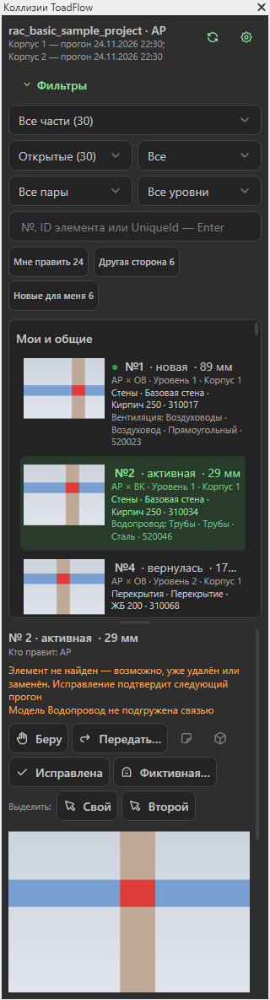
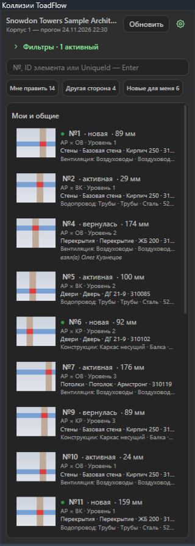

# Коллизии

Панель **«Коллизии ToadFlow»** показывает коллизии открытой модели из ToadFlow: список с картинками, фильтры, переход к коллизии в модели и карточку с действиями. Нужны ToadFlow 2.0.0 и [вход в ToadFlow](Settings#toadflow).

## Открыть панель

**ToadTools → Общие → Коллизии** показывает и скрывает панель; её можно закрепить, как любую панель Revit. Панель сама находит открытую модель в ToadFlow — сначала по пути модели, потом по имени файла. Если подходящих моделей несколько, панель предлагает выбрать; выбор запоминается.

Если модель не участвует в утверждённых проверках, панель пишет об этом и показывает путь, по которому искала.

Если вы не вошли в ToadFlow, панель пишет об этом; кнопка **«Настройки…»** открывает [окно настроек](Settings#toadflow) на разделе ToadFlow, и после входа панель сама перечитывает список.

## Список

- Сверху — модель, раздел и проверки, в которых она участвует, с датой последнего прогона.
- Счётчики — переключатели: **«Мне править N»**, **«Другая сторона N»**, **«Новые для меня N»**. Нажатие включает фильтр, повторное — снимает.
- Фильтры: часть здания, статус, кто правит, пара разделов, уровень, поиск по номеру, ElementId или UniqueId (Enter). Все фильтры, кроме поиска, лежат в сворачиваемом блоке **«Фильтры»**: когда он свёрнут, строка показывает, сколько фильтров включено, например «Фильтры · 2 активных». Поиск виден всегда.
- Синяя точка у строки — коллизию вы ещё не открывали.
- Картинки грузятся только для видимых строк. Если картинки нет, вместо неё написана причина от сервера, например «выгрузка модели удалена».
- ↑/↓ — соседняя строка; ниже последней подгружается следующая страница.

Пара, уровень и поиск запоминаются для каждой модели отдельно; статус и счётчики — общие для всех моделей до закрытия Revit. Состояние блока «Фильтры» (свёрнут или развёрнут) помнится до закрытия Revit.

## Часть здания

Модель может входить в несколько частей проекта — например, в проверки по корпусам. Если частей две и больше, первым в блоке «Фильтры» стоит список **«Часть здания»**: **«Все части (N)»** и каждая часть с числом её коллизий.

- Выбрав часть, вы видите коллизии только этой части. Счётчики «Мне править», «Другая сторона», «Новые для меня» и числа в других фильтрах тоже считаются в пределах части, а в шапке остаётся дата прогона именно этой части.
- При выборе «Все части» под парой разделов в строке коллизии написано имя части.
- Выбранная часть запоминается для каждой модели **между запусками Revit** в `%AppData%\ToadTools\collisions.json`: если вы ведёте один корпус, панель открывается сразу на нём. Если запомненной части больше нет среди частей с коллизиями, панель показывает все части.

> [!NOTE]
> Фильтр по части здания работает с ToadFlow 3.5.0. С более старым сервером списка «Часть здания» в панели нет, остальное работает как раньше.

## Компактный размер

В [настройках](Settings#вид) можно выбрать компактный размер; «Авто» включает его на экранах ниже 900 пикселей. В панели «Коллизии» компактный размер освобождает место для списка:

- блок «Фильтры» по умолчанию свёрнут (в обычном размере развёрнут) — раскройте его нажатием на строку;
- миниатюры в списке меньше, а свой и второй элементы идут в одну строку с многоточием; полный текст — в подсказке;
- перечень частей с датами прогона в шапке занимает одну строку, полный текст — в подсказке;
- картинка в карточке меньше.

Шестерёнка в шапке панели открывает [Настройки](Settings).

## Переход к коллизии

Щелчок по строке:

- открывает 3D-вид **«ToadClash — {пользователь Revit}»** (создаётся при первом переходе);
- ставит секущий куб 2 × 2 × 2 м с местом коллизии в центре; куб стоит по северу проекта — ровно по осям и стенам, а не повёрнут на угол истинного севера; шире — растяните куб сами;
- выделяет оба элемента.

Кнопки **«Свой»** и **«Второй»** в строке «Выделить» карточки выделяют только один элемент — так его легче найти среди систем. Вид и куб не меняются.

Изменения вида — одна транзакция «ToadClash: показать коллизию». Если вид и куб уже нужные, модель не меняется. В модели только для чтения вид не создать — панель объяснит причину.

В Revit 2020–2022 элемент из связи не выделяется: панель пишет, в какой связи его искать.

## Карточка

Под списком — карточка выбранной коллизии: статус, глубина, «Свой элемент» (из открытой модели) и «Второй элемент», картинка, лента.

Высоту списка и карточки меняет «ручка» между ними: потяните её вверх или вниз. Высота запоминается между запусками Revit; двойной щелчок по «ручке» возвращает как было.

Кнопки — как в вебе, но с короткими подписями и значками; полное название — в подсказке при наведении:

| Кнопка | Что делает |
|---|---|
| **Беру** | Вы правите эту коллизию |
| **Передать…** | Выбрать, кто правит; примечание необязательно |
| **Исправлена** | Статус «исправлена (ожидает подтверждения)»: следующий прогон подтвердит исправление или вернёт коллизию |
| **Фиктивная…** | Отметка с обязательным примечанием |
| **Не фиктивная** | Снять отметку «фиктивная» |
| Значок заметки | Примечание — запись в ленту |
| Значок куба | Показать в ToadFlow: 3D коллизии в браузере |
| Выделить: **Свой**, **Второй** | Выделить в Revit только этот элемент |

Статус и «кто правит» проектировщик меняет только в коллизиях своих разделов. Если картинка не получилась, под причиной есть кнопка «Обновить».

## Несколько коллизий сразу

Выделите строки: **Ctrl+щелчок**, **Shift+щелчок**, **Ctrl+A** или **Shift+↑/↓**. Вместо карточки появится полоса «Выделено N» с действиями над всеми выделенными:

| Кнопка | Что делает |
|---|---|
| **Беру** | Вы правите все выделенные |
| **Передать…** | Своя сторона, другая сторона или обе; примечание необязательно |
| **Исправлены** | Статус «исправлена (ожидает подтверждения)» |
| **Фиктивные…** | Одно обязательное примечание на все |
| **Примечание…** | Одна запись в ленту каждой |
| **Снять** | Снять выделение |

Перед «Беру» и «Исправлены» панель спрашивает подтверждение. Права проверяются по каждой коллизии: итог — строкой под фильтрами, например «Изменено 5 из 7. Не изменены: №12 — причина».

## Вставка из буфера

**Ctrl+V** в панели: номер коллизии или ссылка на неё (из чата, отчёта) — панель находит коллизию в открытой модели и показывает её. Ссылка на коллизию другой модели — подсказка, какую модель открыть.

## Если панель не запустилась

Если при запуске Revit панель не зарегистрировалась (конфликт сборок с другим аддином, повреждённая установка), остальные кнопки ToadTools работают, а кнопка «Коллизии» показывает «Панель не запустилась: {причина}». Подробности — в `%LocalAppData%\ToadTools\Clash\startup.log`.

Картинки кешируются в `%LocalAppData%\ToadTools\Clash\images`; файлы старше 30 дней удаляются при запуске.
