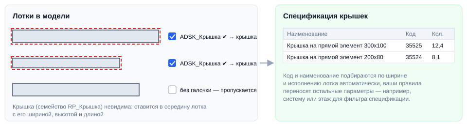

# Разместить крышки

## Введение

Плагин размещает в проекте **невидимые крышки** кабельных лотков, чтобы посчитать их в спецификации. Крышка ставится на каждый лоток, у которого отмечен параметр **ADSK_Крышка**, — с размерами лотка, артикулом и наименованием.

Запуск — **Разместить крышки** на вкладке **ToadTools**, панель **Лотки**.

## Окно плагина

1. **Добавить** — новое правило переноса параметра.
2. **Параметр лотка** — откуда брать значение.
3. **Параметр крышки** — куда записать.

Правила нужны, чтобы потом фильтровать крышки в спецификации (например, по системе, этажу или разделу). Если ничего не переносить — правила можно не добавлять.

Нажмите **«Запуск»**. Во время работы показывается прогресс; «Прервать» откатывает всё — и удаление старых крышек, и создание новых.

## Что делает плагин

1. Удаляет **все** ранее размещённые крышки (экземпляры семейства `RP_Крышка`) — поэтому повторный запуск просто актуализирует их.
2. На каждый лоток с отмеченным **ADSK_Крышка** ставит крышку в середину лотка, поворачивает по направлению лотка и задаёт **ADSK_Размер_Ширина / Высота / Длина** по лотку.
3. По ширине и **ADSK_Исполнение** лотка заполняет артикул и наименование крышки — например, «Крышка на прямой элемент 300x100, горячего цинкования».
4. Переносит параметры по вашим правилам.

> [!NOTE]
> Загружать семейство крышки не нужно — если его нет в проекте, плагин загрузит его сам с общего диска:
> `Y:\12-BIM\Стандарт\Общие семейства и мануалы ко всем шаблонам\Семейства ЭОМ, СС\Соединители лотка\RP_Крышка.rfa`

> [!WARNING]
> Если вы загружали крышку в проект **до 28 января 2026 года**, перед запуском удалите семейство крышки из проекта — плагин загрузит актуальную версию.

> [!NOTE]
> Крышки ставятся только на прямые лотки, не на соединительные детали.

> [!TIP]
> В большой модели работа может занять 15–20 минут. Запускайте плагин, когда нужно актуализировать спецификацию: если весь день двигаете лотки — прогоните его один раз в конце дня.

## Если что-то пошло не так

| Проблема | Что делать |
|---|---|
| Ошибка сразу при запуске | В модели нет ни одного кабельного лотка — плагину не из чего брать список параметров |
| «С загрузкой семейства какая-то шляпа» | Нет доступа к диску `Y:` и семейства нет в проекте — загрузите `RP_Крышка.rfa` вручную |
| Крышек меньше, чем лотков | Крышка ставится только на лотки с отмеченным **ADSK_Крышка**. Проверить можно командой [Покрасить крышки](CableTrays#покраска) |
| В наименовании «имя не найдено» | Нестандартная ширина или исполнение 0 у лотка — поправьте вручную |
