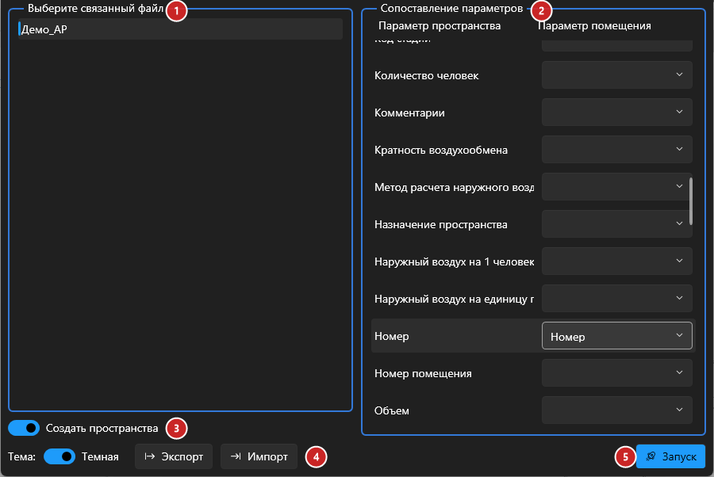
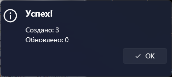

# Создание пространств

## Введение

Плагин создаёт в инженерной модели **пространства** по **помещениям** из связанного файла АР и переносит в них значения параметров — имя, номер, отметки и любые другие. Повторный запуск обновляет параметры уже созданных пространств.

Запуск — **Создание пространств** на вкладке **ToadTools**, панель **Общие**.

## Окно плагина

1. **Связанный файл** — из какой связи брать помещения. После выбора справа появится список параметров.
2. **Сопоставление параметров** — для каждого параметра пространства слева можно выбрать параметр помещения, из которого взять значение. Пустой выбор — параметр не переносится.
3. **Режим работы**:
   - **Создать пространства** — создаёт недостающие пространства и обновляет существующие;
   - **Перенести только значения параметров** — новые пространства не создаются, обновляются только существующие.
4. **Экспорт / Импорт** — сохранить сопоставление параметров в `.json` и загрузить его в следующий раз, чтобы не настраивать заново.
5. **Запуск**.

После работы появится итог — сколько пространств создано и сколько обновлено:

Во время работы показывается прогресс; «Прервать» откатывает все изменения.

> [!TIP]
> Для правильных пространств сразу настройте перенос **Имя → Имя**, **Номер → Номер** и **Смещение сверху → Смещение сверху**.

## Как это работает

- Для каждого помещения связи плагин берёт его точку (чуть выше пола) и ищет пространство, в котором эта точка лежит. Нашлось — обновляет параметры; нет — создаёт новое пространство на **ближайшем по высоте уровне** модели.
- Значения переносятся только в параметры пространства, доступные для записи, и только если у помещения есть выбранный параметр.
- Неразмещённые и неокружённые помещения связи (без площади) пропускаются.

> [!IMPORTANT]
> Чтобы пространства получили правильные границы, у связи АР должна быть включена **«Граница помещения»**: выделите связь → **Изменить тип** → отметьте **Граница помещения**. Иначе Revit предупредит «Пространство — область, которая неправильно окружена».

> [!WARNING]
> Плагин создаёт пространства для **всех** помещений связи. Если в ней несколько корпусов, а нужны пространства по одному, перенесите параметр с корпусом и удалите лишние пространства через ведомость.

## Если что-то пошло не так

| Проблема | Что делать |
|---|---|
| Список связей пустой | В модели нет загруженных связей Revit — загрузите связь АР |
| Справа нет параметров | Выберите связь в списке слева |
| «Пространство — область, которая неправильно окружена» | Включите «Граница помещения» в типе связи (см. выше) и запустите плагин ещё раз — пространства обновятся |
| Пространство появилось не на том этаже | В модели нет уровня на отметке этажа АР — добавьте уровни как в АР |
| «Создано: 0» в режиме «Перенести только значения» | Так и должно быть: этот режим только обновляет уже существующие пространства |
