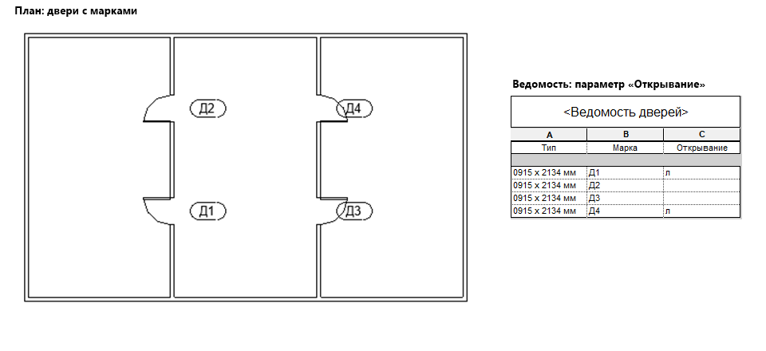

# Открывание дверей

## Введение

Плагин заполняет параметр **«Открывание»** у всех дверей на активном виде: левым дверям записывается **«л»**, у правых параметр остаётся пустым. Так в ведомости дверей сразу видно, какие двери левые.

## Как пользоваться

1. Откройте вид, на котором видны нужные двери (обычно план этажа).
2. Нажмите **Открывание дверей** на вкладке **ToadTools**, панель **АР**.
3. Появится сообщение «Параметр открывание заполнен».

Во время работы показывается прогресс; «Прервать» откатывает изменения. Весь запуск отменяется одним **Ctrl+Z**.

> [!NOTE]
> Если в проекте ещё нет параметра **«Открывание»**, плагин сам создаст его при первом запуске — общий текстовый параметр экземпляра у категории «Двери».

## Как определяется сторона

Сторона считается по тому, как дверь развёрнута в модели — по стрелкам **«Отразить»** у экземпляра:

| Развернута по ширине (⇆) | Развернута по глубине (⇅) | Результат |
|---|---|---|
| нет | нет | «л» |
| да | нет | пусто (правая) |
| нет | да | пусто (правая) |
| да | да | «л» |

> [!WARNING]
> Плагин работает только с семейством **«Дверь»** и аналогами, у которых открывание меняется разворотом через стрелки, а **без разворота дверь левая**. Если открывание задаётся параметром экземпляра или типа, результат будет неверным.

## Если что-то пошло не так

| Проблема | Что делать |
|---|---|
| Параметр не заполнился у части дверей | Эти двери не видны на активном виде — запустите плагин на виде, где они есть |
| Все двери получились наоборот | В вашем семействе дверь без разворота — правая. Плагин рассчитан на семейства, где она левая |
