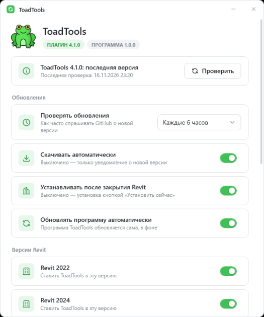

# Установка и обновление

ToadTools не нужно ставить и обновлять руками. Этим занимается небольшая программа ToadTools: она сидит в трее рядом с часами, сама скачивает плагин и ставит новые версии, пока Revit закрыт.

## Установка

1. Скачайте `ToadTools-App-*.msi` со [страницы релизов программы](https://github.com/Alexpivo394/ToadTools.Desktop/releases/latest).
2. Запустите его и нажмите **Установить**. Права администратора не понадобятся — программа ставится только для вас, в `%LocalAppData%\ToadTools\app`.
3. В трее появится зелёная жаба. Она найдёт Revit на компьютере, скачает плагин и разложит его по версиям — вкладка **ToadTools** появится, когда вы в следующий раз откроете Revit.

> [!NOTE]
> Если у вас стоял ToadTools 4.0.x, установщик сам его уберёт — только закройте Revit, иначе кнопка **Установить** не нажмётся. Старую установку «для всех пользователей» (`MultiUser.msi`) нужно удалить вручную в **Параметры → Приложения**; программа подскажет, если её найдёт.

## Как приходят обновления

Раз в несколько часов (по умолчанию — раз в 6) программа заглядывает на GitHub. Если там новая версия, она скачивает её заранее и проверяет цифровую подпись — испорченный или подменённый файл не поставится.

Дальше всё зависит от того, открыт ли Revit:

- **Revit закрыт** — плагин обновляется сразу, вы этого даже не заметите.
- **Revit открыт** — работу никто не прерывает. Появится сообщение **«Доступна версия… Закройте Revit — обновлю сам»**. Как только закроете последний Revit — неважно как, хоть он сам упал, — программа за пару секунд поменяет файлы и напишет **«ToadTools обновлён»**.

Пока программа ждёт, она ничего не опрашивает и не грузит компьютер: о закрытии Revit ей сообщает сама Windows.

> [!TIP]
> Даже если открыть Revit ровно в момент замены, ничего не сломается: файлы меняются целиком, одной операцией. Revit загрузит либо старую версию, либо новую, а не их смесь, и программа просто доставит обновление в следующий раз.

Сама программа тоже обновляется — тихо и в фоне: закрывается, ставит свою новую версию и запускается снова. У неё [свой репозиторий](https://github.com/Alexpivo394/ToadTools.Desktop) и своя нумерация версий.

## Окно программы

Щелчок по значку открывает окно, правая кнопка — меню: **Проверить обновления**, **Установить сейчас**, **Что нового**, **Настройки**, **Выход**.

| Настройка | По умолчанию | Что делает |
|---|---|---|
| Проверять обновления | Каждые 6 часов | Вручную, при запуске Windows, каждые 1/3/6/12 часов или раз в день |
| Скачивать автоматически | Вкл. | Если выключить, программа только сообщит о новой версии, а скачает по кнопке **Проверить обновления** |
| Устанавливать после закрытия Revit | Вкл. | Если выключить, скачанная версия будет ждать кнопку **Установить сейчас** |
| Обновлять программу автоматически | Вкл. | Если выключить, новая версия программы ставится кнопкой **Обновить программу** |
| Версии Revit | Все найденные | Снимите галочку — и из этой версии Revit плагин уберётся, как только Revit будет закрыт |
| Запускать вместе с Windows | Вкл. | Значок появляется в трее сразу после входа в Windows |
| Показывать уведомления | Вкл. | Сообщения о новой версии и о законченной установке |
| Прокси | Системный | Как в Windows, без прокси или свой адрес — если GitHub в сети доступен только через прокси |

Настройки хранятся в `%AppData%\ToadTools\settings.json`, журнал — в `%LocalAppData%\ToadTools\Logs\ToadTools-*.log` (кнопка **Папка логов** в окне).

## Удаление

**Параметры → Приложения → ToadTools → Удалить**, предварительно закрыв Revit. Уйдут и программа, и плагин из всех версий Revit. Настройки в `%AppData%\ToadTools` останутся — пригодятся, если решите поставить снова.

## Если что-то пошло не так

| Что видно | Почему | Что делать |
|---|---|---|
| «Нет связи с GitHub» | Нет интернета или GitHub закрыт прокси | Проверьте прокси в настройках. Программа сама попробует ещё раз по расписанию |
| «Исчерпан лимит запросов к GitHub» | GitHub пускает не больше 60 проверок в час с одного адреса — в офисе за одним IP это бывает | Поставьте проверку пореже. Лимит сбрасывается в течение часа |
| «Подпись … не сходится» | Файл испортился при скачивании или его подменили | Нажмите **Проверить** — файл скачается заново. Не помогло — напишите разработчику |
| «Файлы плагина … заняты другой программой» | Файлы держит не Revit, а, например, антивирус или открытое окно проводника | Закройте проводник в папке Addins и нажмите **Проверить** — установка повторится |
| Вкладки ToadTools нет в Revit | Эта версия Revit выключена в настройках или программа её не нашла | Включите её в разделе **Версии Revit** |
