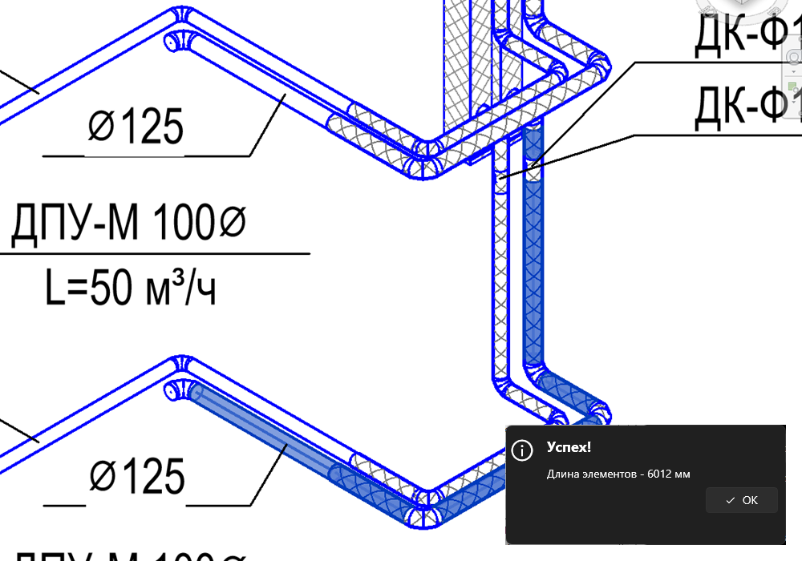

# Длина элементов

## Введение

Быстрый способ узнать суммарную длину выделенных элементов — труб, воздуховодов, лотков, коробов, стен — без спецификации.

## Как пользоваться

1. Выделите элементы на виде — щелчком, рамкой, через фильтр выбора, как удобно.
2. Нажмите **Длина элементов** на вкладке **ToadTools**, панель **Общие**.
3. Появится окно с суммарной длиной в миллиметрах (округлённой до целого).

> [!NOTE]
> Учитываются только элементы, у которых есть параметр **Длина** (линейные элементы: трубы, воздуховоды, лотки, короба, стены и т. п.). Фитинги, арматура, оборудование и другие элементы без длины просто пропускаются — снимать их с выделения не нужно.

> [!TIP]
> Ничего не выделено — получится 0 мм. Удобно выделить трассу целиком: наведите на элемент, нажмите **Tab** до подсветки всей цепочки и щёлкните.
