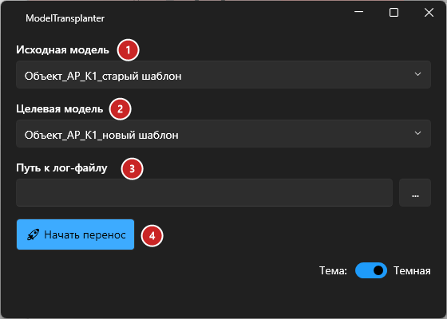
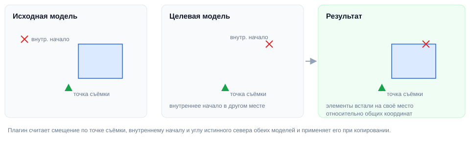

# Копирование элементов

## Введение

Плагин переносит содержимое одной модели в другую — например, при переходе на новый шаблон: элементы копируются в новую модель на те же места, вместе с системами трубопроводов и воздуховодов.

Запуск — **Копирование элементов** на вкладке **ToadTools**, панель **BIM**.

## Порядок работы

1. Откройте в одном Revit **обе модели** — из которой копируете и в которую.
2. Запустите плагин.

   

   1. **Исходная модель** — откуда копировать.
   2. **Целевая модель** — куда копировать.
   3. **Путь к лог-файлу** — кнопка **«…»** выбирает, куда записать лог. По умолчанию — `Документы\TransferElementsLog.txt`.
   4. **Начать перенос**.

3. Дождитесь сообщения «Перенос элементов завершен успешно!». Во время переноса показывается прогресс (сбор элементов, проверка, копирование, регенерация). Кнопка **«Прервать»** останавливает перенос — изменения в целевой модели откатываются.
4. Проверьте результат и сохраните целевую модель.

## Как совмещаются координаты

Модели должны иметь **общую систему координат** (одинаковую точку съёмки). Внутреннее начало и базовая точка могут не совпадать — плагин сам посчитает смещение и поворот (по точке съёмки, внутреннему началу и истинному северу обеих моделей), и элементы встанут куда нужно.

## Что копируется

Элементы модели этих категорий: помещения, стены, перекрытия, потолки, панели витражей, двери, окна, кровли, лестницы, парковочные места, мебель, обобщённые модели, несущие колонны, каркас и фундаменты, части; трубы, гибкие трубы, фитинги, арматура и изоляция труб, сантехприборы, спринклеры, трубопроводные системы; воздуховоды, гибкие воздуховоды, фитинги, арматура и изоляция воздуховодов, воздухораспределители, системы воздуховодов; оборудование, электрооборудование, электроприборы, осветительные приборы и выключатели, кабельные лотки и их фитинги, слаботочные устройства.

**Не копируются**: оси, уровни, опорные плоскости (их берут из нового шаблона), виды, листы, аннотации, а также элементы без геометрии (кроме помещений).

> [!IMPORTANT]
> Если в целевой модели уже есть тип или семейство с таким же именем, используется **тип целевой модели**. Так элементы сразу получают оформление нового шаблона — но проверьте, что одноимённые типы действительно одинаковые.

## Лог

В лог пишется: сколько элементов найдено и перенесено, координаты точек съёмки обеих моделей, применённое смещение и поворот, а также ошибки, если они были.

## Если что-то пошло не так

| Проблема | Что делать |
|---|---|
| «Не выбраны исходный или целевой документ» | Выберите обе модели в списках |
| «Один из документов открыт в режиме только для чтения» | Откройте модели с возможностью редактирования |
| В списках нет нужной модели | Модель должна быть открыта в этом же Revit **до** запуска плагина — перезапустите его |
| Элементы встали со смещением | У моделей разные общие координаты — сначала получите координаты (Управление → Координаты) |
| «Не найдены точки съёмки» | В одной из моделей нет точки съёмки — проверьте модель |
