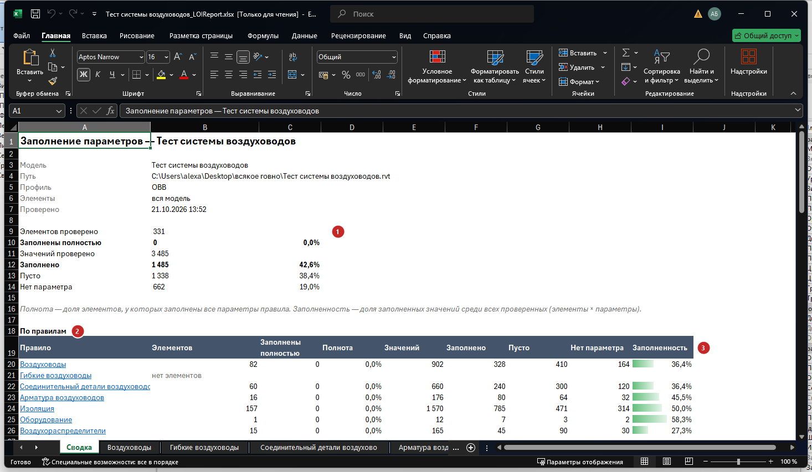
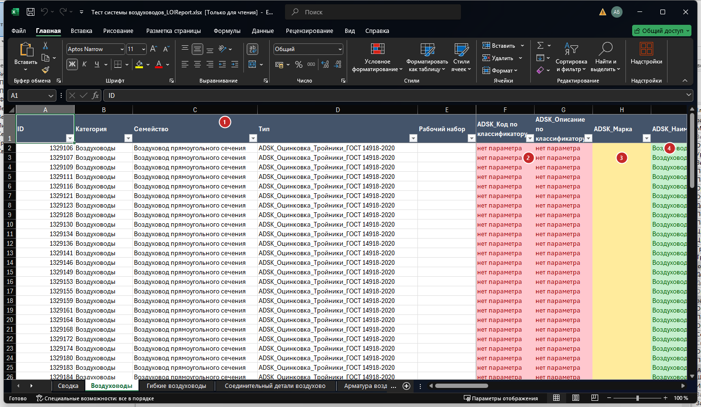
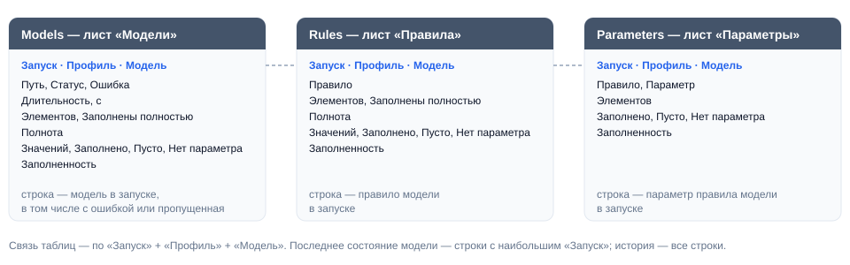

# ParamChecker

## Введение

**ParamChecker** — цифровой ревизор моделей. Он по очереди открывает модели с Revit Server или с диска, отбирает элементы по заданным правилам и проверяет, заполнены ли у них нужные параметры — то есть соответствует ли модель требуемому уровню информации (LOI). Итог — отчёт Excel по каждой модели с понятной сводкой и база для дашбордов, в которой копится история заполнения.

Нажмите **Param Checker** на вкладке **ToadTools**, панель **BIM**. Плагин запускается из любого открытого проекта — хоть пустого: проверяемые модели он открывает сам, а из открытого проекта берёт только названия категорий и подсказки имён параметров.

> [!TIP]
> Удобно заводить по профилю на раздел или объект: в одном профиле — модели раздела и правила, которые к ним относятся.

## Основное окно

1. **Профили** — галочка включает профиль в запуск. Под именем — сколько в профиле моделей и правил. Правый щелчок — **Дублировать** или **Удалить**.
2. **Добавить** — новый профиль; корзина рядом удаляет все профили.
3. **Импорт / Экспорт** — загрузить профили из файла `.json` или сохранить в него, например чтобы поделиться с коллегами.
4. **Настройки** — папка отчётов, открытие моделей, база для дашбордов, тема.
5. **Имя профиля, вид и слово РН** — вид и ключевое слово действуют на все модели профиля.
6. **Модели** — добавить [с Revit Server](#выбор-моделей-с-revit-server), файлы `.rvt` с диска или строку, чтобы вписать путь вручную. Корзина убирает все модели профиля.
7. **Свой вид / своё слово РН** — у отдельной модели. Пусто — как у профиля: подсказка в поле со знаком «=» показывает, что возьмётся.
8. **Добавить правило / Вставить** — новое правило или правило из буфера обмена.
9. **Правило** — название (это имя листа в отчёте), какие элементы проверять и какие параметры. Щелчок по сводке открывает [окно фильтра](#окно-фильтра) или [окно параметров](#окно-параметров).
10. **⋮** — меню правила, см. [Копирование правил](#копирование-правил).
11. **Проверить открытую модель** — [проверка модели, открытой в Revit](#проверка-открытой-модели), по правилам выбранного профиля.
12. **Проверить** — открывает по очереди модели всех отмеченных профилей и проверяет их.

> [!NOTE]
> Профили и настройки сохраняются сами и при следующем запуске открываются как были. Хранятся они в `%AppData%\ToadTools\ParamChecker`.

### Модели профиля

| Поле | Что задаёт |
|---|---|
| **Путь** | `RSN://сервер/папка/модель.rvt` для Revit Server (подходит и `RSN:\\сервер\папка\…`) или путь к файлу. Под путём жирным — имя модели, оно же имя отчёта |
| **Вид** | Вид, с которого собираются элементы, обычно 3D-вид «Navisworks». Пусто — вся модель |
| **Слово РН** | Рабочие наборы, в имени которых есть это слово (без учёта регистра), при открытии остаются закрытыми. Пусто — открываются все |

Модель открывается **с отсоединением** (рабочие наборы сохраняются) и закрывается без сохранения — исходная модель не меняется. По умолчанию модель сначала копируется во временную папку, и в копии связи RVT отключаются: модель открывается без связей и быстрее, а закрывать рабочие наборы связей ключевым словом не нужно. Отключается в [настройках](#настройки).

> [!NOTE]
> Помещения, пространства и зоны не видны на 3D-видах, поэтому они берутся из всей модели, даже если задан вид. Неразмещённые помещения не проверяются.

### Выбор моделей с Revit Server

Кнопка **С Revit Server** открывает дерево сервера:

- галочка на модели отмечает её, на папке — все модели в ней и во вложенных папках;
- поиск ищет по всему серверу — по имени модели или папки;
- **Добавить (N)** добавляет все отмеченные модели разом; модели, которые уже есть в профиле, помечены «уже в профиле».

Сервер выбирается из списка — это серверы из настроек Revit (RSN.ini) и из путей моделей в профилях; имя можно вписать вручную.

> [!TIP]
> Revit Server отвечает медленно, поэтому ParamChecker обходит сервер целиком в фоне — один раз за сеанс Revit, начиная сразу при открытии окна плагина. Каталог запоминается и на диске: после перезапуска Revit дерево показывается сразу, а свежий обход идёт в фоне. **Обновить** нужно, только если на сервере появились новые модели.

### Копирование правил

Меню **⋮** у правила:

| Команда | Что делает |
|---|---|
| **Дублировать** | Копия правила в этом же профиле |
| **Копировать правило** | Кладёт правило в буфер обмена |
| **Вставить фильтр** | Заменяет фильтр этого правила фильтром скопированного |
| **Вставить параметры** | Заменяет список параметров этого правила списком скопированного |
| **Удалить** | Удаляет правило |

Скопированное правило целиком вставляет кнопка **Вставить** над списком правил — в том числе в другой профиль.

## Окно фильтра

1. **Отбирать** — как сочетаются категории и условия:

   | Вариант | Какие элементы проверяются |
   |---|---|
   | Только категории | Все элементы выбранных категорий |
   | Только условия | Элементы любых категорий, подходящие под условия |
   | Категории ИЛИ условия | Элементы выбранных категорий и, кроме них, любые элементы, подходящие под условия |
   | Категории И условия | Элементы выбранных категорий, подходящие под условия |

2. **Категории** — отметьте нужные; поиск сужает список, «Только выбранные» оставляет отмеченные. Выбранные категории показываются в начале списка.
3. **Связь условий** — **Все условия (И)** или **Любое условие (ИЛИ)**.
4. **Условие** — *параметр — оператор — значение*. Имя параметра подсказывается при вводе.
5. **Группа** — несколько условий, которые должны выполняться **все вместе (И)**. Сама группа — одно условие верхнего уровня; пригодится при связи «ИЛИ».
6. **Условие / Группа условий** — добавить.
7. **Применить** — фильтр сохраняется в правиле.

| Оператор | Когда выполняется |
|---|---|
| Равно, Не равно | Значение совпадает (не совпадает) без учёта регистра. Если в условии число, а параметр числовой — сравниваются числа: `1200` равно «1200 мм» |
| Больше, Больше или равно, Меньше, Меньше или равно | Числа сравниваются в единицах проекта: «Длина больше 1000» — это миллиметры. Текст сравнивается, если начинается с числа («150 мм»). Не число — условие не выполняется |
| Содержит, Не содержит, Начинается с, Заканчивается на | Сравнение текста без учёта регистра |
| Параметр есть, Параметра нет | У элемента или его типа есть (нет) такого параметра — заполнен он или нет, не важно |
| Заполнен, Не заполнен | У параметра есть значение (нет значения или нет самого параметра) |

> [!TIP]
> Пример на скриншоте: проверяются трубы, у которых *ADSK_Наименование = Труба* **или** одновременно *Имя системы = В1* и *ADSK_Марка* не заполнена.

## Окно параметров

1. **Имя параметра** — начните вводить, подсказки появятся сами; **Enter** добавляет параметр.
2. **Список** — параметры в порядке столбцов отчёта; стрелки меняют порядок, крестик убирает.
3. **⚠** — такого имени нет ни в ФОП, ни в открытом проекте, ни среди системных параметров Revit. Скорее всего, это опечатка. Сверка работает, когда в Revit подключён ФОП.
4. **Вставить список** — добавляет имена из буфера обмена: столбец из Excel или строки из текста, по одному имени в строке.
5. **Применить** — список сохраняется в правиле.

Параметр ищется у экземпляра, а если его там нет — у типа. Подсказки берутся из ФОП, из параметров и семейств открытого проекта и из системных параметров Revit, поэтому для настройки правил открывать проверяемые модели не нужно.

## Настройки

1. **Папка для отчётов** — по умолчанию `Рабочий стол\ParamChecker`. Отчёты раскладываются по папкам профилей, здесь же — журнал каждого запуска.
2. **Только элементы с незаполненными параметрами** — в листах правил остаются только элементы с пропусками; отчёты по большим моделям становятся в разы меньше. Итоги и проценты считаются по всем элементам.
3. **Не загружать связи RVT** — модель открывается из временной копии без связей (включено по умолчанию).
4. **База для дашбордов** — дописывать итоги каждого запуска в общую книгу Excel, см. [База для дашбордов](#база-для-дашбордов).
5. **Файл базы** — пусто: `ParamChecker_База.xlsx` в папке отчётов. Можно указать общий файл на сетевом диске.
6. **Тема** — светлая или тёмная.

## Запуск и отчёт

Нажмите **Проверить**. Перед запуском ParamChecker проверяет отмеченные профили и показывает все ошибки сразу: нет моделей или правил, у правила не выбраны параметры или категории, модель добавлена дважды.

В окне прогресса видно, какая модель обрабатывается и что с ней происходит:

- **Пропустить модель** — бросить текущую модель (например, если она зависла на открытии) и перейти к следующей;
- **Прервать** — остановить всю проверку.

Ошибка в одной модели не обрывает проверку. В конце — итог по каждой модели и предложение открыть папку с отчётами. Если у модели нет нужного вида, в итоге написано, какие 3D-виды в ней есть.

Отчёт по модели — `<папка отчётов>\<профиль>\<модель>_LOIReport.xlsx`. Если прежний отчёт открыт в Excel, новый сохраняется рядом со временем в имени.

### Лист «Сводка»

1. **Итоги модели** — сколько элементов и значений проверено, доля заполненных, пустых и отсутствующих.
2. **По правилам** — итоги каждого правила; название — ссылка на его лист. Правило, под которое в модели нет элементов, помечено «нет элементов».
3. **Заполненность** с гистограммой — сразу видно, где провал. Ниже — такая же таблица по каждому параметру каждого правила.

| Показатель | Что значит |
|---|---|
| **Полнота** | Доля элементов, у которых заполнены все параметры правила |
| **Заполненность** | Доля заполненных значений среди всех проверенных: элементы × параметры |

### Листы правил

1. **Элемент** — ID, категория, семейство, тип и рабочий набор. Шапка и эти столбцы закреплены, у шапки — автофильтр.
2. 🟥 **нет параметра** — у элемента и его типа нет такого параметра.
3. 🟨 **пусто** — параметр есть, но не заполнен.
4. 🟩 **значение** — параметр заполнен.

В последнем столбце — доля заполненных параметров элемента. Фильтр Excel по цвету ячейки быстро оставляет только проблемные элементы.

## Проверка открытой модели

**Проверить открытую модель** проверяет модель, открытую сейчас в Revit, по правилам выбранного профиля — модели профиля при этом не открываются. Вид берётся из профиля. Отчёт и строки в базе — такие же, как при обычном запуске; имя модели — по файлу хранилища, даже если открыта локальная копия.

## База для дашбордов

Каждый запуск дописывает итоги в одну книгу Excel — `ParamChecker_База.xlsx` (путь задаётся в настройках). В книге три таблицы Excel, по одной на лист; каждая строка — одно измерение с датой запуска, поэтому история заполнения копится сама:

База подключается к **Power BI** один раз (**Получить данные → Excel**, таблицы `Models`, `Rules`, `Parameters`) и обновляется кнопкой **Обновить**. Таблицы связываются по столбцам «Запуск», «Профиль» и «Модель»; последнее состояние модели — строки с наибольшим «Запуск», динамика — все строки.

> [!TIP]
> К модели можно привязать свою таблицу проектов (заказчик, стадия, ответственный) по столбцу «Модель» — это полное имя файла модели без `.rvt`.

> [!NOTE]
> Если файл базы занят (открыт в Excel), строки копятся до конца запуска, а если файл так и не освободился — пишутся в соседний файл с датой в имени. Об этом скажет итог запуска.

## Если что-то пошло не так

| Проблема | Что делать |
|---|---|
| «Перед проверкой поправьте профили» | Исправьте перечисленное: в профиле нет моделей или правил, у правила не выбраны параметры или категории |
| Окно выбора с Revit Server пустое | Проверьте имя сервера и подключение к сети (VPN). Если модели на сервере появились недавно — **Обновить** |
| Модель долго открывается или зависла | **Пропустить модель** в окне прогресса. Проверьте путь; при выключенной настройке «Не загружать связи RVT» закройте РН связей ключевым словом |
| «Нет вида …» в итоге | Укажите вид, который есть в модели (итог перечисляет её 3D-виды), или оставьте поле вида пустым — тогда проверяется вся модель |
| В отчёте весь столбец красный | Параметра нет у этой категории или имя написано не так, как в модели. В окне параметров такие имена помечены ⚠ (при подключённом ФОП) |
| Правило «нет элементов» | Фильтр не нашёл элементов: проверьте категории, условия и вид |
| «Больше / меньше» не срабатывает | Значение условия — число в единицах проекта, без единиц: `1000`, а не `1000 мм` |
| Профили старой версии | Загрузите их кнопкой **Импорт** — файлы прежних версий ParamChecker читаются |
| Подробности ошибки | Журнал запуска — в папке отчётов, `ParamChecker_<дата>.log` |
