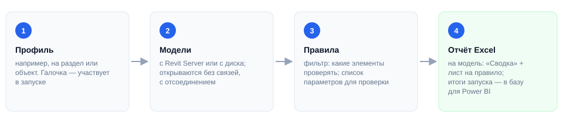
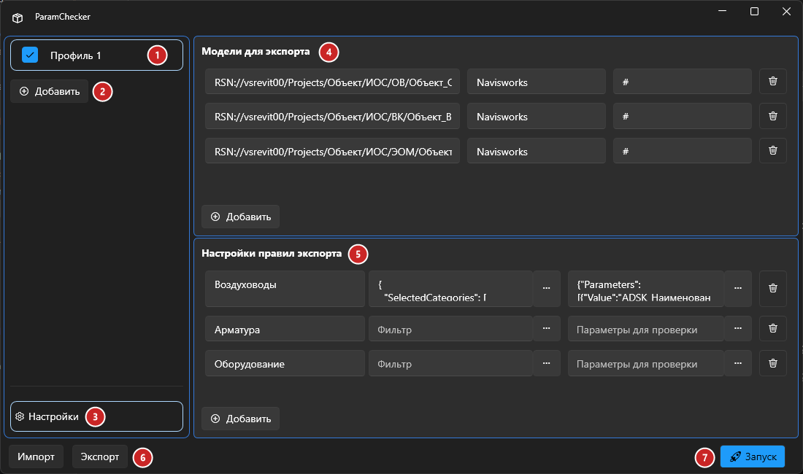
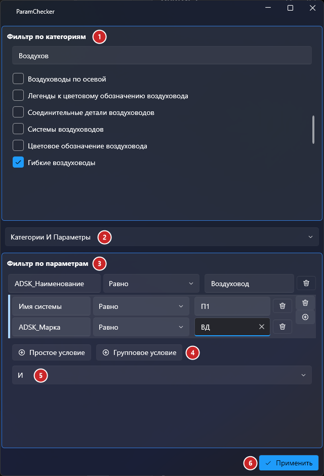
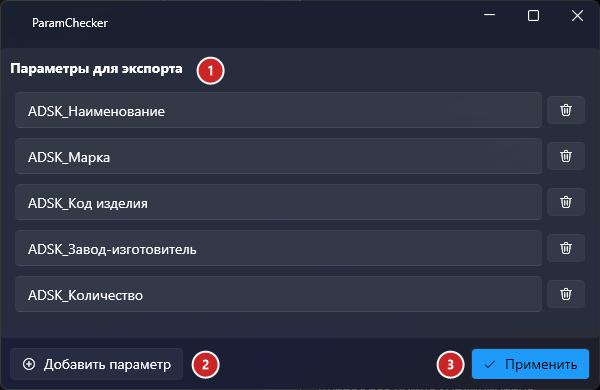
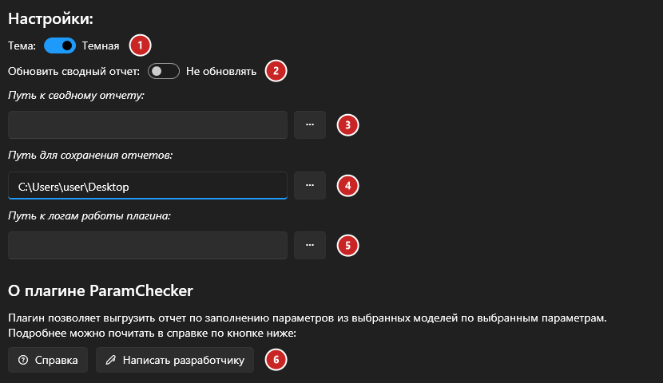
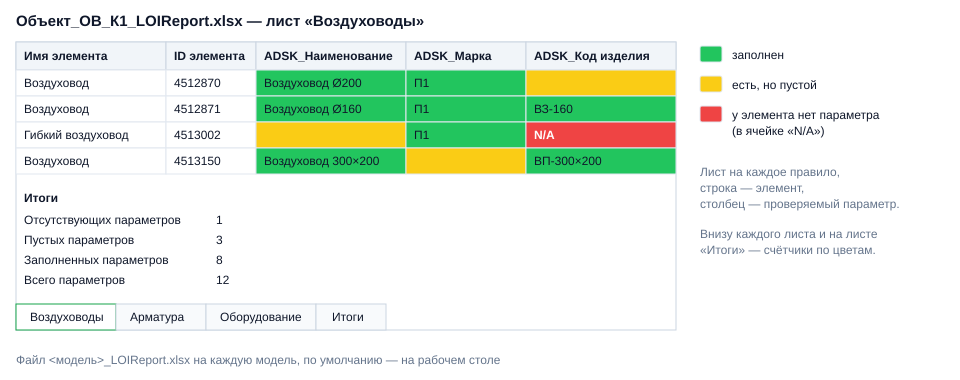

# ParamChecker

## Введение

**ParamChecker** — цифровой ревизор моделей. Он по очереди открывает модели с Revit Server, отбирает элементы по заданным правилам и проверяет, заполнены ли у них нужные параметры — то есть соответствует ли модель требуемому уровню информации (LOI). Итог — отчёт Excel по каждой модели, где каждая ячейка подсвечена зелёным, жёлтым или красным.

Плагин работает с открытым проектом (любым — он нужен только как точка запуска): нажмите **Param Checker** на вкладке **ToadTools**, панель **BIM**.

> [!TIP]
> Удобно заводить по профилю на раздел или объект: в одном профиле — модели раздела и правила, которые к ним относятся.

## Основное окно

1. **Профиль** — галочка слева от имени включает профиль в запуск. Правый щелчок по профилю — **Переименовать** или **Удалить**.
2. **Добавить** — новый профиль.
3. **Настройки** — тема, пути к отчётам и логу, сводный отчёт.
4. **Модели для экспорта** — какие модели проверять.
5. **Настройки правил экспорта** — что и как проверять в каждой модели.
6. **Импорт / Экспорт** — загрузить профили из файла `.json` или сохранить в него.
7. **Запуск** — проверяет все отмеченные профили.

> [!WARNING]
> Профили **не сохраняются** при закрытии окна. Настроили профили — нажмите **«Экспорт»** и сохраните их в `.json`, в следующий раз загрузите кнопкой **«Импорт»**. Этим же файлом удобно делиться с коллегами.

### 4. Модели для экспорта

Каждая строка — одна модель, кнопка **«Добавить»** добавляет строку, корзина — удаляет.

| Поле | Что вписать |
|---|---|
| **Путь к модели Revit** | Путь к модели на Revit Server, например `RSN://vsrevit00/Projects/Объект/ИОС/ОВ/Объект_ОВ_К1_R22.rvt` |
| **Имя вида** | Вид модели, с которого собираются элементы для проверки |
| **Ключевое слово РН** | Рабочие наборы, в имени которых есть это слово (без учёта регистра), при открытии остаются закрытыми — например, связи и подложки. Пусто — открываются все РН |

Модель открывается **с отсоединением** (рабочие наборы сохраняются) и закрывается без сохранения — исходная модель на сервере не меняется.

### 5. Правила экспорта

Каждое правило — отдельный лист в отчёте Excel.

| Поле | Что задаёт |
|---|---|
| **Название** | Имя правила и листа в Excel |
| **Фильтр** | Какие элементы проверять. Кнопка **«…»** открывает [окно фильтра](#окно-фильтра) |
| **Параметры для проверки** | Какие параметры проверять у отобранных элементов. Кнопка **«…»** открывает [окно параметров](#окно-параметров) |

> [!NOTE]
> В полях «Фильтр» и «Параметры» хранится JSON. Вручную его писать не нужно — для этого есть окна настройки. Поля редактируемые, чтобы можно было скопировать готовый фильтр или список параметров в другое правило.

## Окно фильтра

1. **Фильтр по категориям** — отметьте категории; строка поиска сужает список.
2. **Логика между категориями и параметрами**:

   | Вариант | Какие элементы попадут в проверку |
   |---|---|
   | Только категории | Элементы отмеченных категорий, условия по параметрам не учитываются |
   | Только параметры | Элементы, прошедшие условия по параметрам, категории не учитываются |
   | Категории ИЛИ Параметры | Подходящие хотя бы по одному из критериев |
   | Категории И Параметры | Подходящие и по категории, и по параметрам |

3. **Фильтр по параметрам** — условия вида *параметр — оператор — значение*. Операторы: равно, не равно, больше, больше или равно, меньше, меньше или равно, содержит, не содержит, существует, не существует.
4. **Простое условие** добавляет одно условие, **Групповое условие** — группу. Внутри группы условия всегда связаны через **И**, новое условие в группу добавляет кнопка **⊕** справа от неё.
5. **Логика между условиями** — **И** (должны выполняться все простые условия и группы) или **ИЛИ** (достаточно одного).
6. **Применить** — фильтр сохраняется в поле правила.

> [!TIP]
> Пример на скриншоте: проверяются гибкие воздуховоды, у которых *ADSK_Наименование = Воздуховод* **и** одновременно *Имя системы = П1 и ADSK_Марка = ВД*. Поставьте внизу **ИЛИ** — и в проверку попадут элементы, подходящие под первое условие **или** под группу.

## Окно параметров

1. Список параметров, которые проверяются у отобранных элементов. Имя — точно как в Revit.
2. **Добавить параметр** — новая строка, корзина — удалить.
3. **Применить** — список сохраняется в поле правила.

## Настройки

1. **Тема** — светлая или тёмная.
2. **Обновить сводный отчёт** — после каждой модели записывает её итоги в общий файл BIM-отдела. ***Если вы не BIM-координатор, это вам не нужно.***
3. **Путь к сводному отчёту** — пусто: `Y:\13-BIM (разработка)\07_Bim отдел\Проекты и модели.xlsx`.
4. **Путь для сохранения отчётов** — куда класть отчёты по моделям. По умолчанию — рабочий стол.
5. **Путь к логам** — пусто: `Документы\ParamCheckerLog.txt`.
6. **Справка** открывает инструкцию в базе знаний BIM-отдела (Yonote), **Написать разработчику** — Telegram-чат разработчика.

> [!NOTE]
> Настройки этой страницы хранятся на компьютере и запоминаются между запусками.

## Запуск и отчёт

Нажмите **«🚀 Запуск»**. Плагин проверит, что в каждом отмеченном профиле есть хотя бы одна модель и одно правило, и начнёт выгрузку. В окне прогресса видно, какая модель обрабатывается и что с ней происходит (открытие, правило, сохранение):

- **«Пропустить модель»** — бросить текущую модель (например, если она зависла на открытии) и перейти к следующей;
- **«Прервать»** — остановить всю выгрузку.

Ошибка в одной модели не обрывает выгрузку — модель попадёт в итог. В конце появится сводка: сколько моделей выгружено, какие пропущены и какие упали с ошибкой.

На каждую модель создаётся файл `<модель>_LOIReport.xlsx`:

| Цвет | Значение |
|---|---|
| 🟩 Зелёный | Параметр заполнен |
| 🟨 Жёлтый | Параметр есть, но пустой |
| 🟥 Красный, `N/A` | У элемента нет такого параметра |

## Если что-то пошло не так

| Проблема | Что делать |
|---|---|
| «Нет профилей для экспорта» | Добавьте профиль кнопкой «Добавить» или загрузите кнопкой «Импорт» |
| «Добавьте хотя бы одну модель / одно правило» | В отмеченном профиле пустой список моделей или правил |
| Модель долго открывается или зависла | «Пропустить модель» в окне прогресса; проверьте путь и ключевое слово РН — лишние открытые РН сильно замедляют открытие |
| В отчёте весь столбец красный | Параметра нет у этой категории или имя написано не так, как в модели |
| В отчёте пустой лист | Фильтр не нашёл элементов: проверьте категории, условия и имя вида |
| Подробности ошибки | Смотрите лог — путь задаётся в настройках |
