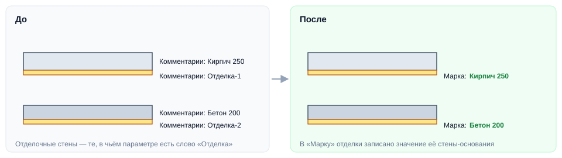
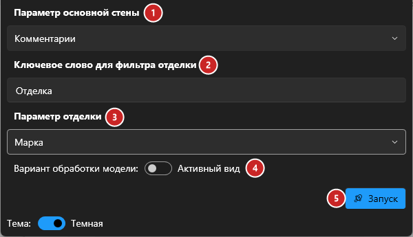

# Основание отделки

## Введение

Плагин находит для каждой **отделочной стены** стену, к которой она примыкает (стену-основание), и записывает в параметр отделки значение параметра основания — например, материал или тип конструкции. Так в ведомости отделки сразу видно, по какому основанию она выполняется.

Запуск — **Основание отделки** на вкладке **ToadTools**, панель **АР**.

## Подготовка

Плагину нужен один параметр, который заполнен и у стен-оснований, и у отделочных стен:

- у **стен-оснований** в нём значение, которое нужно передать (например, `Кирпич 250`, `Бетон 200`);
- у **отделочных стен** в нём есть общее **ключевое слово** (например, `Отделка`) — по нему плагин отличает отделку от основных стен.

## Окно плагина

1. **Параметр основной стены** — откуда брать значение (и в котором у отделки стоит ключевое слово).
2. **Ключевое слово для фильтра отделки** — стена считается отделочной, если в её параметре есть это слово (без учёта регистра).
3. **Параметр отделки** — куда записать значение основания.
4. **Вариант обработки**: **Активный вид** — только стены на текущем виде, **Вся модель** — все стены.
5. **Запуск**. Во время работы показывается прогресс; «Прервать» откатывает изменения.

Выбранные параметры, ключевое слово и вариант запоминаются до следующего запуска.

> [!NOTE]
> Если у основания параметр пустой или отделка ни к чему не примыкает, её параметр не меняется.

## Если что-то пошло не так

| Проблема | Что делать |
|---|---|
| Ничего не записалось | Проверьте ключевое слово: оно должно быть в параметре отделочных стен, а у основных стен — не быть |
| У части отделки пусто | Отделочная стена не касается основания (зазор) или у основания не заполнен параметр |
| Записалось у основных стен | В параметре основной стены тоже встречается ключевое слово — выберите более точное слово |
