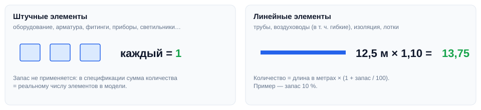
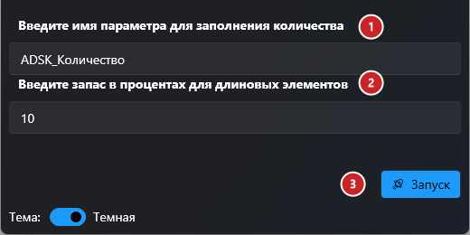

# Записать количество

## Введение

Плагин заполняет параметр количества у всех инженерных элементов модели: штучным элементам ставит **1**, линейным — **длину в метрах** с заданным запасом. После этого спецификация может просто суммировать один параметр.

Запуск — **Запись количества** на вкладке **ToadTools**, панель **Общие**.

## Как пользоваться

1. **Имя параметра** для записи количества — обычно `ADSK_Количество`, но можно любой числовой параметр.
2. **Запас в процентах** для линейных элементов: `10` — к длине добавится 10 %. `0` — без запаса.
3. **Запуск** — плагин обработает элементы во всей модели. Во время работы показывается прогресс; «Прервать» откатывает изменения. В конце — сколько элементов получили количество и сколько нет.

## Какие элементы обрабатываются

| Тип | Категории | Что записывается |
|---|---|---|
| **Штучные** | Обобщённые модели, оборудование, электрооборудование, сантехприборы, соединительные детали труб, воздуховодов и лотков, арматура воздуховодов, воздухораспределители, спринклеры, арматура трубопроводов, электроприборы, осветительные приборы и выключатели, слаботочные устройства (пожарная и охранная сигнализация, связь, данные, вызов медсестры) | `1` |
| **Линейные** | Трубы, гибкие трубы, изоляция труб, воздуховоды, гибкие воздуховоды, изоляция воздуховодов, кабельные лотки | Длина, м × (1 + запас / 100) |

> [!NOTE]
> Параметр должен быть **числовым** и доступным для записи. Элементы без такого параметра пропускаются.

> [!NOTE]
> После работы в папке **Документы** появится лог `QuantityCheckLog.txt`: сколько элементов обработано и список тех, кому количество не записалось, с причиной («Параметр не найден», «Параметр только для чтения», «Не удалось получить длину»).

## Если что-то пошло не так

| Проблема | Что делать |
|---|---|
| Количество не появилось у части элементов | Откройте `Документы\QuantityCheckLog.txt` — там ID элементов и причина |
| «Параметр не найден» | У этой категории нет параметра с таким именем — добавьте его в проект или проверьте написание |
