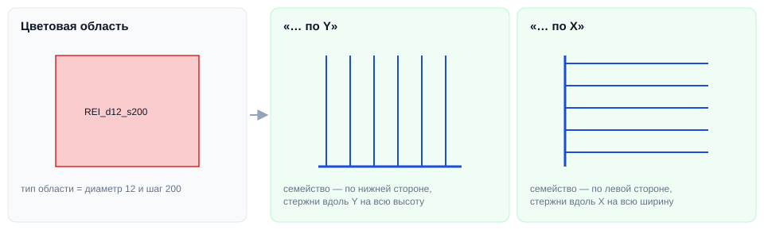

# Армирование по цвету

## Введение

Инструмент для КР: армирование сначала раскладывается на виде обычными **цветовыми областями** (быстро и наглядно), а потом плагин одной командой заменяет их **семействами армирования** нужного диаметра, шага и длины.

Команды — в выпадающей кнопке **Армирование** на вкладке **ToadTools**, панель **КР**:

| Команда | Семейство | Направление стержней |
|---|---|---|
| **R-SHP-Армирование по Y** | R-SHP-01 - Дополнительная | Вдоль Y (вертикально на виде) |
| **R-SHP-Армирование по X** | R-SHP-01 - Дополнительная | Вдоль X (горизонтально на виде) |
| **R-SUM-Армирование по Y** | R-SUM - Распределение по прямой - стержень | Вдоль Y |
| **R-SUM-Армирование по X** | R-SUM - Распределение по прямой - стержень | Вдоль X |

## Как пользоваться

1. Загрузите в проект семейства армирования **R-SHP-01 - Дополнительная** и/или **R-SUM - Распределение по прямой - стержень** с типами `D10-A500C` … `D36-A500C`.
2. Нарисуйте армирование прямоугольными **цветовыми областями**. Тип области задаёт диаметр и шаг: `REI_d<диаметр>_s<шаг>`, например `REI_d12_s200` — Ø12 с шагом 200.
3. **Выделите** области, которые нужно заменить.
4. Запустите команду нужного семейства и направления. Появится сообщение «Заменено: N».

Что происходит с каждой областью:

- семейство ставится по нижней стороне области (для «по Y») или по левой (для «по X») — на ту же длину, что и сторона;
- **Длина стержней** — длина другой стороны области;
- **REI.LNG.Шаг** — шаг из имени типа области;
- тип семейства — диаметр из имени типа области (`D12-A500C`);
- цветовая область удаляется.

## Поддерживаемые типы областей

Диаметры **10, 12, 16, 20, 25, 28, 32, 36** мм, шаги **100, 125, 200, 250** мм — типы от `REI_d10_s100` до `REI_d36_s250`.

> [!WARNING]
> Области других типов, непрямоугольные или повёрнутые области пропускаются и остаются на виде — их нужно заменить вручную.

## Если что-то пошло не так

| Проблема | Что делать |
|---|---|
| «Не выбраны семейства для замены» | Выделите цветовые области перед запуском |
| «Заменено: 0» | Тип области не из списка `REI_d…_s…`, или в проекте нет семейства армирования с нужным типом `D…-A500C` |
| Стержни легли не в ту сторону | Отмените (**Ctrl+Z**) и запустите команду с другим направлением |
