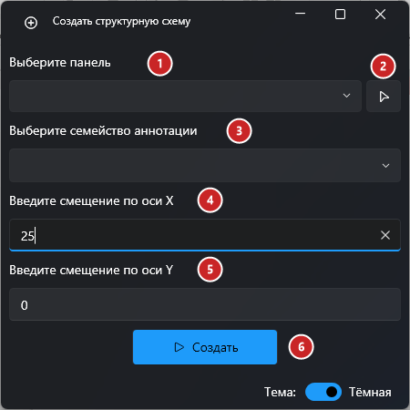
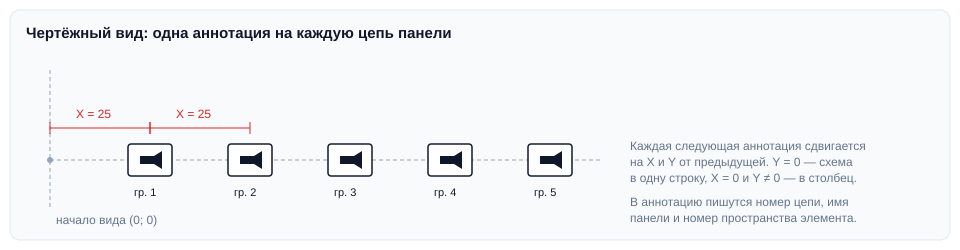

# Структурная схема

## Введение

Плагин строит структурную (однолинейную) схему сетей связи по выбранной панели: на чертёжный вид ставится по одной аннотации на каждую цепь панели, и в аннотации сразу заполняются номер цепи, имя панели, номер пространства и другие данные подключённого элемента.

Запуск — **Структурная схема** на вкладке **ToadTools**, панель **Сети связи**.

> [!WARNING]
> Запускайте плагин на **чертёжном виде**, на котором должна появиться схема. На другом виде плагин покажет «Активный вид не является чертежным видом».

## Окно плагина

1. **Панель** — в списке только панели (категория «Электрооборудование»), к которым подключены цепи. Панели показываются по **Имени панели**; панель без имени будет в списке как `[Unnamed <ID>]`.
2. **Выбрать на плане** — окно скроется, укажите панель в модели.
3. **Семейство аннотации**, из которого строится схема, — выберите **RR_CC_Видеокамера**.
4. **Смещение по X** между аннотациями — для стандартной горизонтальной схемы `25`.
5. **Смещение по Y** — для горизонтальной схемы `0`.
6. **Создать** — схема появится на чертёжном виде, плагин сообщит «Схема успешно создана».

> [!NOTE]
> Если семейства камеры нет в проекте, загрузите его с общего диска:
> `Y:\12-BIM\Стандарт\Общие семейства и мануалы ко всем шаблонам\Семейства ЭОМ, СС\2D Типовые аннотации\RR_CC_Видеокамера.rfa`

## Как раскладываются аннотации

Первая аннотация ставится в точку (X; Y) от начала вида, каждая следующая — ещё на X и Y дальше. В аннотацию переносятся:

| Параметр аннотации | Откуда |
|---|---|
| Номер цепи | Имя цепи |
| Имя панели, Номер пространства, ADSK_Этаж, ADSK_Номер здания, Видимость_3 | Первый элемент, подключённый к цепи |
| Видимость_1, Видимость_2, Текстовое поле | Тип подключённого элемента |

## Если что-то пошло не так

| Проблема | Что делать |
|---|---|
| «Активный вид не является чертежным видом» | Создайте чертёжный вид (Вид → Чертёжный вид) и запустите плагин на нём |
| Панели нет в списке | К ней не подключено ни одной цепи. Панели без имени ищите по `[Unnamed <ID>]` или выберите кнопкой на плане |
| «Нет подключённых цепей к выбранной панели» | Подключите оборудование к цепям этой панели |
| Аннотации наложились друг на друга | Задайте смещение по X (или по Y для вертикальной схемы) |
