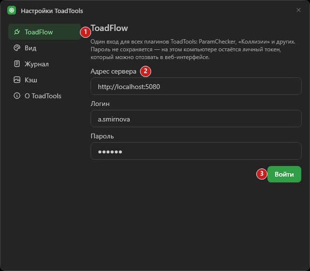
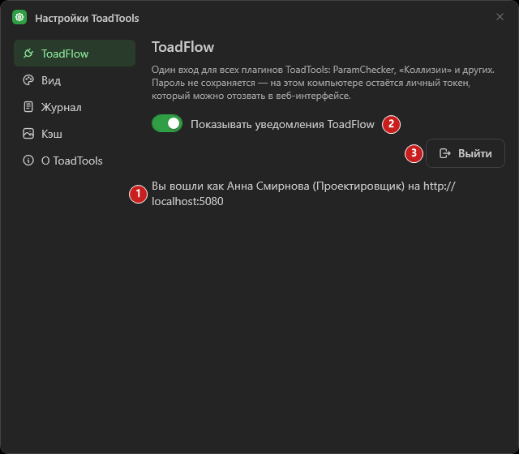
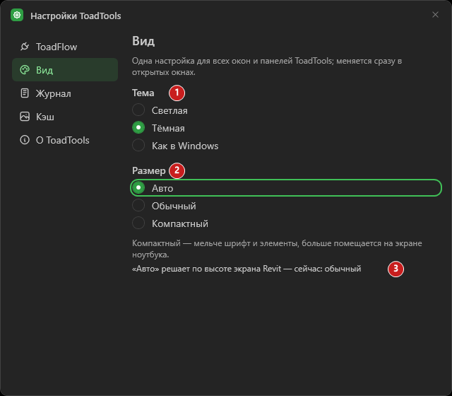
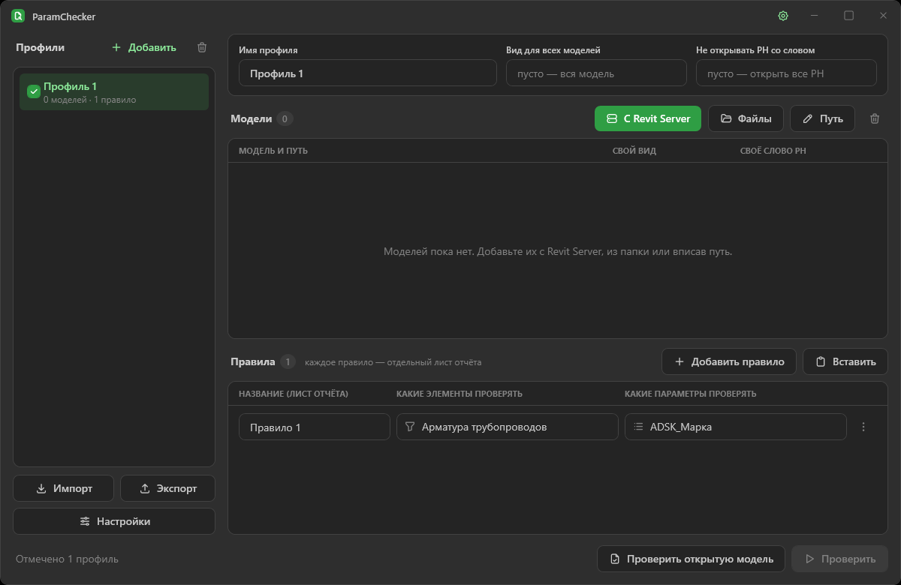
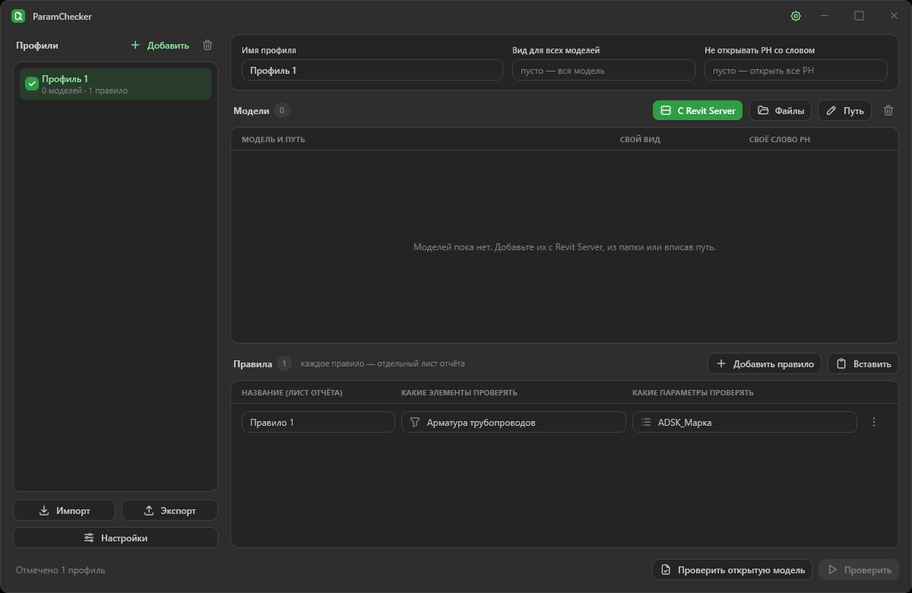
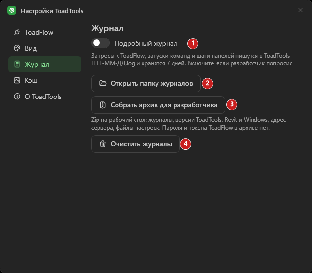

# Настройки

**ToadTools → ToadTools → Настройки** — одно окно для всего, что относится сразу ко всем инструментам: вход в ToadFlow, тема и размер окон, журнал работы и кэш. Те же настройки открываются кнопкой-шестерёнкой в заголовке окон инструментов и в шапке панелей «Коллизии» и «Семейства».

1. Список разделов — слева.
2. Адрес сервера, логин и пароль.
3. Кнопка **«Войти»**.

В окне пять разделов.

## ToadFlow

Один вход для всех плагинов, которые работают с сервером ToadFlow: панелей «Коллизии» и «Семейства» и отправки итогов ParamChecker.

### Вход

1. Введите адрес ToadFlow (например, `https://toadflow.example.ru`), логин и пароль и нажмите **«Войти»**.
2. ToadTools получает на сервере личный токен этого компьютера («ToadTools — {имя компьютера}»). Пароль не сохраняется.
3. Токен хранится в `%AppData%\ToadTools\toadflow.json`, зашифрованный для текущего пользователя Windows: другой пользователь этого компьютера его не прочитает.

После входа в разделе видно, кто вошёл.

1. Кто вошёл, его роль и адрес сервера.
2. Переключатель уведомлений.
3. Кнопка **«Выйти»**.

Если токен отозвали или пользователя отключили, плагины пишут «Подключение к ToadFlow устарело — войдите заново» и открывают это окно.

### Уведомления

Переключатель **«Показывать уведомления ToadFlow»** включает всплывающее окно справа внизу: заявки на семейства, ошибки расписаний, новые коллизии.

### Выход

**«Выйти»** отзывает токен на сервере и удаляет его с компьютера. Токен, перенесённый из настроек старого ParamChecker (его создавали в веб-интерфейсе), на сервере остаётся — его отзывают в вебе.

Если сервер недоступен, вход удаляется только с компьютера; токен на сервере остаётся до отзыва в вебе.

Права плагинов зависят от роли в ToadFlow — см. [ToadFlow в ToadTools](ToadFlow).

## Вид

Настройки вида общие для всех окон и панелей ToadTools и действуют сразу, закрывать окна не нужно. Переключателей «Тёмная тема» в окнах инструментов больше нет.

1. Тема.
2. Размер.
3. Подсказка, что решил «Авто» на вашем экране.

**Тема**

| Значение | Что делает |
|---|---|
| Светлая | Светлое оформление |
| Тёмная | Тёмное оформление |
| Как в Windows | Следует настройке Windows «Режим приложений» и меняется вместе с ней |

Если раньше вы включали «Тёмную тему» в любом окне, она остаётся выбранной.

**Размер**

| Значение | Что делает |
|---|---|
| Авто | Компактный, если рабочая область экрана Revit ниже 900 пикселей (по масштабу Windows). Это ноутбук 1920×1080 при масштабе 125 % и крупнее. Иначе — обычный |
| Обычный | Привычные размеры шрифтов и элементов |
| Компактный | Мельче шрифт, ниже кнопки и поля, меньше отступы: на экране ноутбука помещается больше |

При выборе «Авто» окно подписывает, что решилось на вашем экране: «сейчас: компактный» или «сейчас: обычный».

> [!NOTE]
> Окна ToadTools не открываются больше рабочей области экрана: если окно рассчитано на 1100×800, а экран меньше, оно уменьшается и ставится по центру. Длинное содержимое прокручивается.

| Обычный | Компактный |
|---|---|
|  |  |

В «Коллизиях» компактный размер меняет и раскладку — см. [Коллизии](Collisions#компактный-размер).

## Журнал

Журнал нужен, когда разработчик просит прислать, что происходило. Файлы лежат в `%LocalAppData%\ToadTools\Logs`.

Цифры на снимке — по порядку строк таблицы.

| Элемент | Что делает |
|---|---|
| **Подробный журнал** | Пишет запросы к ToadFlow (метод, адрес, код ответа и время — без заголовков, тел и токена), запуски команд и шаги панелей в `ToadTools-ГГГГ-ММ-ДД.log`. Файлы хранятся 7 дней, старше удаляются. Включайте, если попросил разработчик |
| **Открыть папку журналов** | Открывает папку `Logs` в проводнике |
| **Собрать архив для разработчика** | Кладёт на рабочий стол zip: журналы, версии ToadTools, Revit и Windows, адрес сервера, файлы настроек из `%AppData%\ToadTools`. Пароля и токена ToadFlow в архиве нет |
| **Очистить журналы** | Удаляет файлы журналов |

Без «Подробного журнала» ошибки команд всё равно пишутся в `Revit-errors.log` в той же папке.

## Кэш

**«Очистить кэш миниатюр коллизий»** удаляет картинки коллизий, скачанные с ToadFlow (`%LocalAppData%\ToadTools\Clash\images`); рядом показан их размер. «Коллизии» скачают нужные заново. Файлы старше 30 дней и так удаляются при запуске Revit.

## О ToadTools

Версия ToadTools и год Revit; кнопки **«Вики ToadTools»** и **«Список изменений»** открывают эти страницы в браузере.

## Если что-то пошло не так

| Что видите | Что делать |
|---|---|
| «Подключение к ToadFlow устарело — войдите заново» | Войдите в разделе ToadFlow ещё раз: токен отозвали или пользователя отключили |
| Размер «Авто» выбрал не тот | Выберите «Обычный» или «Компактный» вручную |
| Нужно показать разработчику, что происходит | Включите «Подробный журнал», повторите действие, нажмите «Собрать архив для разработчика» и пришлите zip с рабочего стола |
