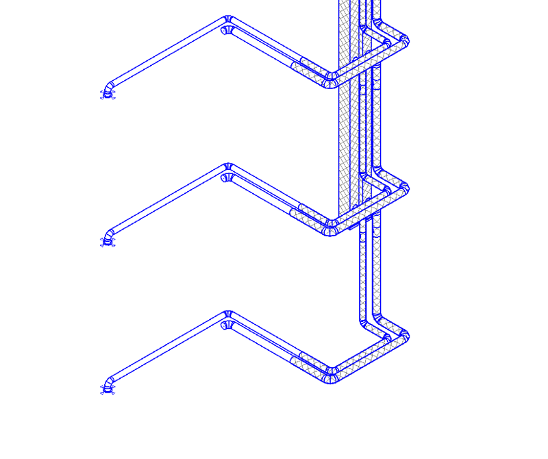
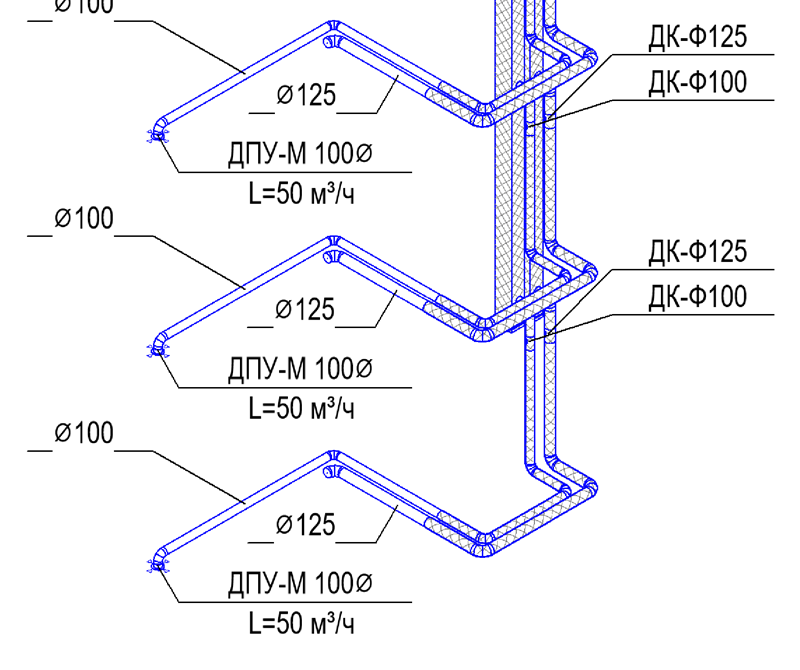
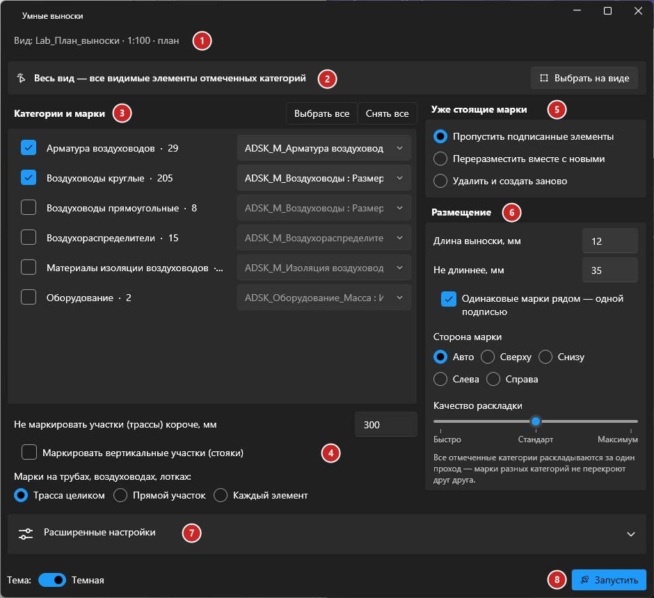
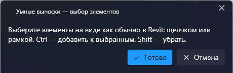
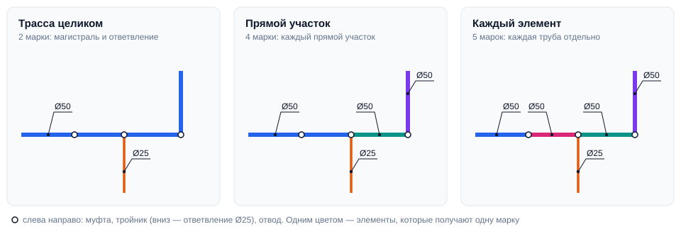
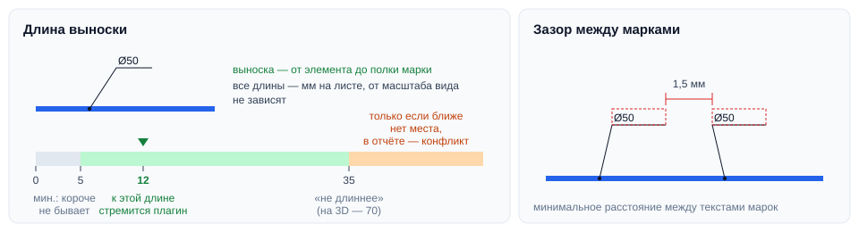
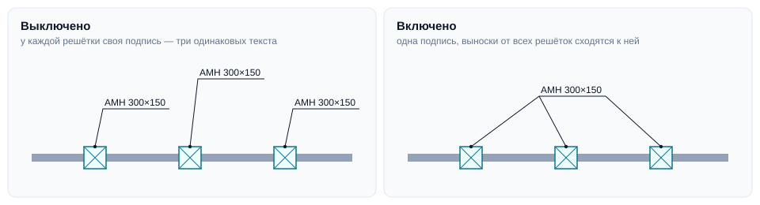
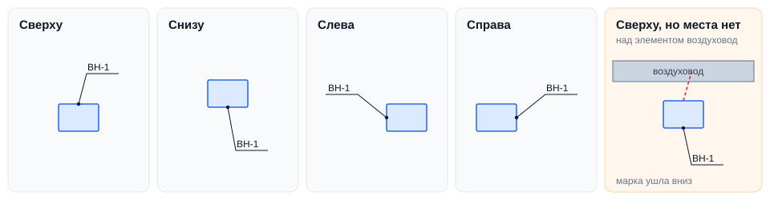
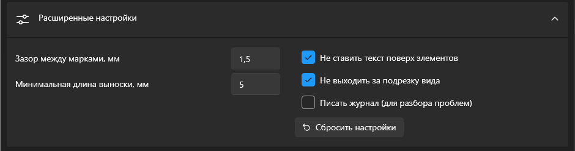
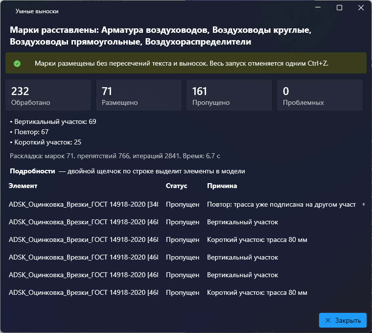

# Умные выноски

## Введение

**Умные выноски** расставляют марки на всех видимых элементах выбранных категорий активного вида — сразу на весь вид или только на выбранные элементы. Марки ставятся рядом со своими элементами, тексты не налезают друг на друга, выноски не перекрещиваются, уже стоящие марки и аннотации учитываются.

| До | После |
|:---:|:---:|
|  |  |

Аксонометрическая схема вентиляции: один запуск, режим «Трасса целиком», категории — воздуховоды, арматура и воздухораспределители.

Плагин работает на планах, разрезах, фасадах и 3D-видах (на 3D — только на ортогональных, см. [3D-виды](#3d-виды)). Весь запуск отменяется одним нажатием **Ctrl+Z**.

## Как запустить

1. Откройте вид, который нужно промаркировать.
2. Если нужно промаркировать только часть элементов — выделите их.
3. Нажмите **«Умные выноски»** на вкладке **ToadTools**, панель **Общие**.

## Основное окно

1. **Вид** — имя, масштаб и тип активного вида.
2. **Что маркировать** — весь вид или только выбранные элементы.
3. **Категории и марки** — какие категории маркировать и каким типом марки.
4. **Трубы, воздуховоды, лотки и короба** — сколько марок ставить на линейные элементы.
5. **Уже стоящие марки** — что делать с элементами, у которых марка уже есть.
6. **Размещение** — длина выноски, общие подписи, сторона марки, качество раскладки.
7. **Расширенные настройки** — зазоры, обход элементов, подрезка, журнал.
8. **Запустить** — начинает расстановку.

Окно запоминает все настройки и выбранные типы марок между запусками.

### 2. Весь вид или только выбранные

По умолчанию маркируются **все видимые элементы** отмеченных категорий. Если перед запуском были выделены элементы, окно откроется в режиме **«Только выбранные»**, а кнопка рядом переключает обратно на **«Весь вид»**.

Чтобы выбрать элементы, не закрывая плагин, нажмите **«Выбрать на виде»**. Окно скроется, появится панель выбора:

Выбирайте как обычно в Revit: щелчком или рамкой, **Ctrl** — добавить к выбранным, **Shift** — убрать. Нажмите **«Готово»** — окно плагина откроется снова с выбранными элементами. **«Отмена»** просто закрывает панель.

> [!TIP]
> Лишнее в выделении не мешает: аннотации, марки и элементы категорий без загруженных марок плагин отбросит сам. Изоляция выбранных труб и воздуховодов добавляется автоматически.

### 3. Категории и марки

Отметьте категории и для каждой выберите **тип марки**. В списке есть только те категории, элементы которых видны на виде **и** для которых в проект загружено семейство марки — своей категории или мультикатегорийное.

> [!NOTE]
> Воздуховоды разделены на **круглые** и **прямоугольные** — обычно у них разные марки.

Если нужной категории нет в списке — загрузите в проект семейство марки для неё.

### 4. Трубы, воздуховоды, лотки и короба

Блок появляется, когда отмечена хотя бы одна линейная категория.

- **Не маркировать участки короче** — короткие куски (в режиме «Трасса целиком» — трассы) не подписываются. По умолчанию 300 мм в модели.
- **Маркировать вертикальные участки (стояки)** — по умолчанию стояки не подписываются.
- **Марки на трубах, воздуховодах, лотках** — сколько марок ставить:

| Режим | Сколько марок |
|---|---|
| **Трасса целиком** (по умолчанию) | Одна марка на трассу. Трасса — участки одного размера и системы, соединённые отводами, муфтами, арматурой или прямым проходом тройника. Ответвление тройника — уже другая трасса |
| **Прямой участок** | Марка на каждый прямой участок: соосные куски одного размера и системы, соединённые напрямую или муфтой |
| **Каждый элемент** | Марка на каждую трубу, воздуховод, лоток — даже если они идут подряд по одной прямой |

Подробнее о режиме **«Трасса целиком»**:

- марка ставится на тот участок трассы, который стоит свободнее (не в пучке труб), при равенстве — на самый длинный;
- если текст марки вдоль трассы меняется (например, марка показывает расход), подпись получает каждая часть трассы со своим текстом;
- части трассы на разной высоте (после подъёма, опуска или утки больше 50 мм) подписываются каждая отдельно — на плане они выглядят как разные трубы. Участки с уклоном (канализация) остаются одной трассой;
- если на трассе уже есть марка и выбрано «Пропустить подписанные», трасса повторно не подписывается.

### 5. Уже стоящие марки

| Вариант | Что происходит |
|---|---|
| **Пропустить подписанные элементы** (по умолчанию) | Старые марки остаются как есть, маркируются только элементы без марок. Новые марки обходят старые |
| **Переразместить вместе с новыми** | Старые марки остаются (со своим типом), но передвигаются: раскладываются заново вместе с новыми |
| **Удалить и создать заново** | Старые марки маркируемых элементов удаляются, марки ставятся с нуля выбранным типом |

### 6. Размещение

**Длина выноски** — к этой длине плагин стремится, **не длиннее** — допустимый максимум. Все длины — в мм на листе, поэтому от масштаба вида не зависят.

Если рядом с элементом места нет, выноска может выйти длиннее максимума: так подпись остаётся читаемой, а не ложится на соседнюю. Такие марки попадают в отчёт с конфликтом «выноска длиннее максимума». На 3D-видах максимум свой (по умолчанию 70 мм) и запоминается отдельно.

**Одинаковые марки рядом — одной подписью** (включено по умолчанию). Если у соседних решёток, клапанов или оборудования одинаковый текст марки, подпись ставится один раз, а выноски от всех элементов (до четырёх) сходятся к ней. Трубы и воздуховоды так не объединяются. Технически это отдельные марки, стоящие в одном месте, — их можно разнести вручную.

**Сторона марки** (только планы и разрезы) — куда от элемента уходит выноска: **сверху**, **снизу**, **слева** или **справа**. На другую сторону марка уходит, только если на заданной для неё нет места: подпись легла бы на другую подпись, на толстый элемент или за подрезку вида. **Авто** (по умолчанию) — сторону выбирает плагин, туда, где свободнее. На 3D-видах настройки нет: там стороны зависят от поворота вида.

**Качество раскладки**:

| Качество | Когда выбирать |
|---|---|
| **Быстро** | Большие виды с тысячами марок, черновой проход |
| **Стандарт** (по умолчанию) | Обычная работа |
| **Максимум** | Дольше, но марки ложатся плотнее и аккуратнее — для чистовых видов |

### 7. Расширенные настройки

| Настройка | По умолчанию | Что делает |
|---|---|---|
| Зазор между марками | 1,5 мм | Минимальное расстояние между текстами марок, мм на листе |
| Минимальная длина выноски | 5 мм | Короче выноска не бывает |
| Не ставить текст поверх элементов | вкл. | Текст марки не закрывает элементы толще 1,5 мм на листе (воздуховоды, оборудование). Тонкие линии (например, на аксонометрических схемах) и края элементов под текстом допускаются, если рядом с элементом иначе места нет. Если выключить, текст может лечь и на толстый элемент, но только когда свободного места нет |
| Не выходить за подрезку вида | вкл. | Марки не выносятся за область подрезки |
| Писать журнал | выкл. | Подробный журнал запуска в `%LocalAppData%\ToadTools\Logs` — пригодится, если что-то пошло не так |

Кнопка **«Сбросить настройки»** возвращает все значения по умолчанию; отмеченные категории и типы марок при этом сохраняются.

## Запуск и отчёт

Нажмите **«Запустить»**. Пока идёт расстановка, показывается прогресс; запуск можно отменить — модель вернётся в исходное состояние.

После запуска откроется отчёт:

- **Счётчики** — сколько элементов обработано, сколько марок размещено, сколько элементов пропущено и сколько марок с проблемами.
- **Причины** — почему элементы пропущены: уже промаркирован, короткий участок, трасса уже подписана на другом участке, вертикальный участок, вне подрезки вида и т. д.
- **Подробности** — таблица по каждому элементу. **Двойной щелчок** по строке закрывает отчёт и выделяет элементы этой строки в модели.
- **«Выделить проблемные»** — выделяет в модели элементы, марки которых стоит поправить вручную.
- **«Открыть журнал»** — появляется, если включена запись журнала.

> [!TIP]
> Не понравился результат — нажмите **Ctrl+Z**: весь запуск отменяется одним шагом. Поменяйте настройки и запустите снова.

## 3D-виды

Марки на 3D-виде Revit ставит только после **блокировки ориентации** вида. Если вид не заблокирован, плагин предупредит об этом в окне и перед запуском спросит разрешения заблокировать его. Снять блокировку можно потом командой Revit «Разблокировать вид».

> [!NOTE]
> Стандартный вид «{3D}» без имени заблокировать нельзя — он будет переименован в «Умные выноски 3D». Если заблокировать вид не удалось, плагин заблокирует его копию с той же ориентацией и откроет её.

Перспективные 3D-виды не поддерживаются — переключите вид в ортогональный режим.

## Полезно знать

> [!TIP]
> Все отмеченные категории раскладываются за один проход, поэтому марки разных категорий не перекрывают друг друга. Лучше запускать плагин один раз на все категории, чем по одной.

> [!NOTE]
> Элементы, сдвинутые на виде командой «Переместить элементы» (например, раздвинутые этажи на схеме), маркируются там, где они нарисованы на виде.

> [!WARNING]
> Плагин маркирует только элементы текущего проекта — элементы из связанных файлов не подписываются.

## Если что-то пошло не так

| Проблема | Что делать |
|---|---|
| Плагин пишет, что на виде нет элементов, или в списке нет нужной категории | Загрузите в проект семейство марки для этой категории (или мультикатегорийную марку) и проверьте, что элементы видны на виде |
| Часть элементов осталась без марок | Посмотрите причины в отчёте: короткий участок, стояк, вне подрезки. Уменьшите минимальную длину или включите маркировку стояков |
| Марки стоят с конфликтом | Нажмите «Выделить проблемные» и поправьте их вручную. Помогает увеличить «не длиннее», выбрать качество «Максимум» или включить «Одинаковые марки рядом — одной подписью» |
| Непонятное поведение | Включите «Писать журнал», повторите запуск и пришлите журнал разработчику |
