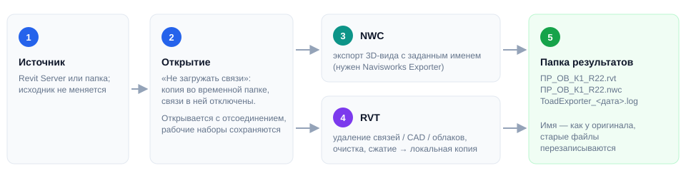
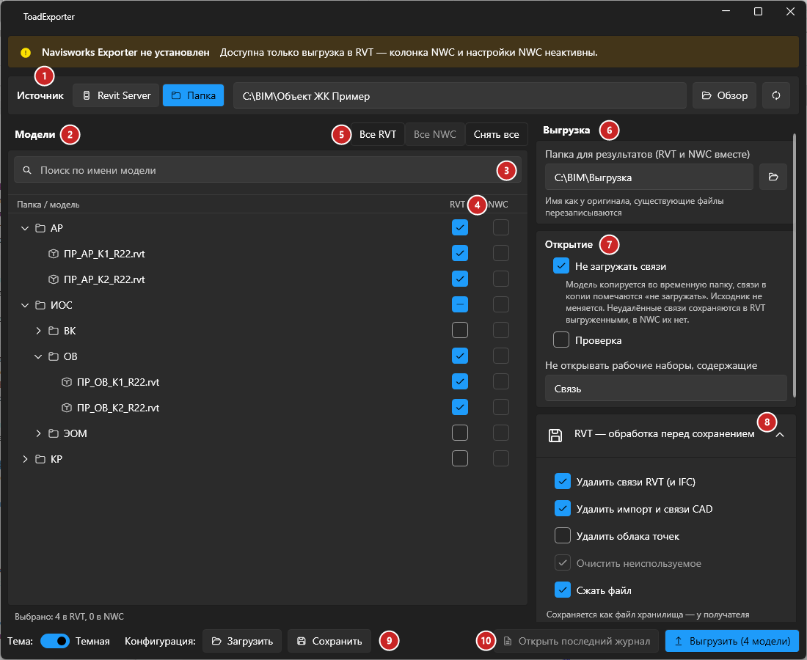
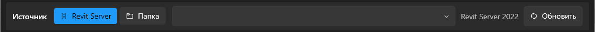
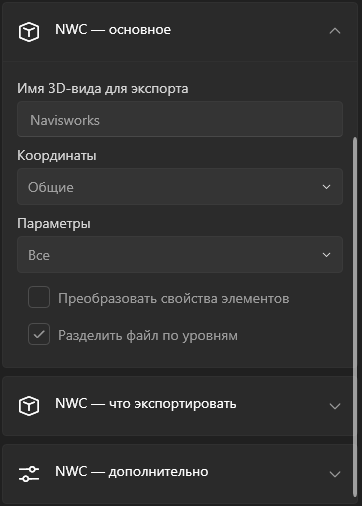

# ToadExporter

## Введение

**ToadExporter** пакетно выгружает модели с Revit Server или из папки в **RVT** (локальная копия, файл хранилища) и/или **NWC** для Navisworks. Отмечаете модели галочками, задаёте папку результатов — и плагин сам по очереди откроет, обработает и сохранит каждую модель. Исходные модели при этом не меняются.

Запуск — кнопка **Toad Exporter** на вкладке **ToadTools**, панель **BIM**. Нужен любой открытый проект или просто запущенный Revit.

## Основное окно

1. **Источник** — **Revit Server** или **Папка** (см. [ниже](#1-источник)).
2. **Модели** — дерево папок и моделей источника.
3. **Поиск по имени модели** — фильтрует дерево.
4. **Колонки RVT и NWC** — в какие форматы выгружать модель. Галочка на папке отмечает всё её содержимое, частично отмеченная папка показана чёрточкой.
5. **Все RVT / Все NWC / Снять все** — быстрые отметки для всего дерева.
6. **Папка для результатов** — куда сохранять RVT и NWC.
7. **Открытие** — как открывать модели.
8. **Блоки настроек** RVT и NWC (сворачиваются).
9. **Конфигурация** — сохранить настройки и отмеченные модели в `.json` или загрузить их обратно.
10. **Открыть последний журнал** и **Выгрузить** — на кнопке видно, сколько моделей отмечено.

> [!NOTE]
> Если на компьютере не установлен **Navisworks Exporter** для вашей версии Revit, вверху окна появится предупреждение: колонка NWC и настройки NWC будут неактивны, доступна только выгрузка в RVT.

### 1. Источник

Один запуск работает только с одним источником.

**Revit Server** — выберите сервер из списка: это те же серверы, что Revit показывает в окне открытия (`C:\ProgramData\Autodesk\Revit Server <год>\Config\RSN.ini` той же версии, что запущенный Revit). Имя можно вписать вручную. Версия Revit Server совпадает с версией Revit, кнопка **«Обновить»** перечитывает дерево.

**Папка** — укажите папку с моделями или выберите её кнопкой **«Обзор»**. В дереве — все `.rvt` из папки и вложенных папок, кроме резервных копий Revit (`_backup` и файлов вида `имя.0001.rvt`); папки без моделей не показываются.

### 2–5. Дерево моделей

- Галочка на папке отмечает всё её содержимое, включая вложенные папки; содержимое сервера при этом догружается целиком.
- Если внутри папки отмечена только часть моделей, у папки — частичное состояние (чёрточка); щелчок по ней отмечает всё.
- Поиск фильтрует модели по части имени среди уже загруженных папок.
- Под деревом показано, сколько моделей отмечено в каждом формате.

### 7. Открытие

| Настройка | По умолчанию | Что делает |
|---|---|---|
| **Не загружать связи** | вкл. | Модель копируется во временную папку `%TEMP%\ToadExporter`, и в копии связи помечаются «не загружать» — все рабочие наборы открыты, а связи не грузятся. Исходник не меняется. Неудалённые связи сохраняются в RVT выгруженными, в NWC их нет |
| **Проверка** | выкл. | Revit проверит и исправит модель при открытии (Audit) — заметно дольше |
| **Не открывать рабочие наборы, содержащие** | пусто | Рабочие наборы, в имени которых есть это слово (например, `Связь`), останутся закрытыми. Их элементы не попадут в NWC |

Модели открываются **с отсоединением** от хранилища, рабочие наборы сохраняются.

### 8. RVT — обработка перед сохранением

| Настройка | По умолчанию | Что делает |
|---|---|---|
| Удалить связи RVT (и IFC) | вкл. | Удаляет из выгружаемой копии связанные модели |
| Удалить импорт и связи CAD | вкл. | Удаляет DWG и другие CAD-подложки |
| Удалить облака точек | выкл. | Удаляет облака точек |
| Очистить неиспользуемое | вкл. | Удаляет неиспользуемые типы, семейства и материалы. **Только Revit 2024 и новее** |
| Сжать файл | вкл. | Сохраняет со сжатием |

Модель совместной работы сохраняется в папку результатов **локальной копией** с рабочими наборами — так же, как её создаёт `RevitServerTool createLocalRVT`. Файл хранилища этой копии остаётся во временной папке и удаляется после выгрузки, поэтому при открытии копии Revit сообщит, что файл хранилища недоступен. Модель без совместной работы сохраняется обычным файлом.

### 8. NWC

- **Имя 3D-вида для экспорта** — из какого вида выгружать NWC (по умолчанию `Navisworks`). Если в модели такого вида нет, NWC для неё пропускается, а в итоге будет пометка.
- **Координаты** (общие или внутренние), **Параметры** (какие свойства элементов попадут в NWC), **Преобразовать свойства элементов**, **Разделить файл по уровням**.
- **NWC — что экспортировать**: связанные модели Revit, связанные файлы CAD, части, геометрия помещений, помещения как атрибут, источники света.
- **NWC — дополнительно**: ID элементов, URL, поиск отсутствующих материалов, коэффициент фасетизации.

Это те же параметры, что в стандартном окне экспорта Navisworks. NWC выгружается **до** обработки RVT, поэтому удаление связей и CAD на него не влияет.

## Выгрузка

Нажмите **«Выгрузить»**. Перед стартом плагин проверит настройки и предупредит, если:

- не отмечено ни одной модели или не указана папка результатов;
- нет прав на запись в папку результатов;
- папка результатов совпадает с папкой модели — исходник был бы перезаписан;
- несколько моделей называются одинаково и перезапишут друг друга (можно продолжить или вернуться).

Во время выгрузки окно прогресса показывает текущую модель и шаг (копирование, открытие, экспорт NWC, сохранение RVT):

- **«Пропустить модель»** — бросить текущую модель и перейти к следующей;
- **«Прервать»** — остановить выгрузку; текущая модель закроется без сохранения.

Ошибка в одной модели не останавливает выгрузку — модель отмечается в журнале с текстом ошибки.

В конце появится итог: сколько моделей выгружено, что пропущено, где были ошибки — и предложение открыть журнал. Журнал `ToadExporter_<дата>_<время>.log` лежит в папке результатов, его можно открыть и позже кнопкой **«Открыть последний журнал»**.

> [!TIP]
> Регулярная выгрузка одного и того же набора моделей? Отметьте модели, настройте всё один раз и нажмите **Конфигурация → Сохранить**. В следующий раз — **Загрузить**: настройки применятся, источник перечитается, сохранённые модели отметятся, а папки с ними раскроются (отметки, сделанные до загрузки, снимаются). Если какой-то модели из конфигурации в источнике уже нет, плагин покажет их список. Тема и свёрнутые блоки в конфигурацию не входят.

> [!NOTE]
> Окно запоминает последние настройки между запусками.

## Если что-то пошло не так

| Проблема | Что делать |
|---|---|
| Колонка NWC серая | Не установлен Navisworks Exporter для этой версии Revit — установите его (бесплатно, с сайта Autodesk) |
| Пустой список серверов | Revit Server не настроен на этом компьютере (`RSN.ini`). Впишите имя сервера вручную |
| «Нет доступа на запись в папку результатов» | Выберите папку, в которую у вас есть права, или создайте её |
| NWC не создан, в итоге «вид не найден» | В модели нет 3D-вида с указанным именем — создайте его или поменяйте имя в настройках NWC |
| Модель зависла на открытии | «Пропустить модель», затем попробуйте ключевое слово для закрытия тяжёлых рабочих наборов |
| Revit при открытии выгруженного RVT пишет, что файл хранилища недоступен | Так и задумано: это локальная копия, а её файл хранилища удалён после выгрузки. Работайте с копией как с отсоединённой моделью |
| «Очистить неиспользуемое» неактивно | Функция доступна только в Revit 2024 и новее |
