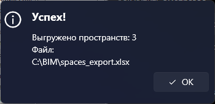
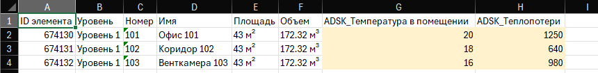
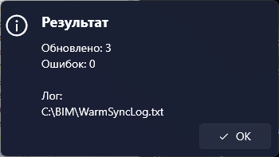

# Синхронизация теплопотерь

## Введение

Набор команд для обмена температурой и теплопотерями между пространствами Revit и Excel: выгружаете пространства в таблицу, заполняете в ней расчётные значения и загружаете их обратно — они попадают в параметры пространств и отображаются в марках.

Все команды — в выпадающей кнопке **Теплопотери** на вкладке **ToadTools**, панель **ОВ**:

| Команда | Что делает |
|---|---|
| **Заполнение номеров пространств** | Записывает пространствам номера по помещениям АР |
| **Запись ID пространств** | Записывает ID каждого пространства в параметр «ID элемента» |
| **Экспорт пространств в Excel** | Выгружает пространства в таблицу |
| **Импорт значений из Excel** | Загружает температуру и теплопотери обратно в пространства |

## 1. Подготовьте проект

В проекте нужны текстовый параметр **«ID элемента»** у пространств и параметры **ADSK_Температура в помещении** и **ADSK_Теплопотери**. Добавить их можно двумя способами.

**Способ 1** — скопировать ведомость **«Э_пространства»** из модели
`Y:\12-BIM\Стандарт\Общие семейства и мануалы ко всем шаблонам\Авто заполнение теплопотерь в пространствах\Пространства.rvt`

**Способ 2** — **Управление → Параметры проекта → Добавить…**, заполнить как на скриншоте и нажать **ОК**:

## 2. Создайте пространства

Плагином **[Создание пространств](CreateSpaces)**.

## 3. Заполните номера пространств

**Теплопотери → Заполнение номеров пространств**. Команда находит для каждого пространства помещение в связи АР и записывает в **Номер** пространства номер, собранный из параметров помещения:

**Корпус** (только цифры) + **Этаж** (только цифры, без «Э») + **Номер квартиры на этаже** + **Номер помещения** (или **Номер**)

Например, корпус `1`, этаж `Э05`, квартира `03`, помещение `2` → `105032`. Пустые части пропускаются.

> [!IMPORTANT]
> Учитываются только связи, в имени файла которых есть **`_AR_`** или **`_АР_`**, например `Объект_AR_K1.rvt`. Связи с другими именами пропускаются — если подходящей связи нет, команда так и напишет в итоге.

## 4. Запишите ID пространств

**Теплопотери → Запись ID пространств** — у всех пространств модели в параметр **«ID элемента»** записывается их ID. По нему импорт потом найдёт пространство.

## 5. Выгрузите пространства в Excel

**Теплопотери → Экспорт пространств в Excel** — выберите, куда сохранить файл (по умолчанию `spaces_export.xlsx`).

Откройте файл и заполните два последних столбца:

| Столбец | Что в нём |
|---|---|
| A — **ID элемента** | По нему импорт находит пространство. **Не меняйте** |
| B–F — Уровень, Номер, Имя, Площадь, Объём | Для справки, при импорте не читаются |
| G — **ADSK_Температура в помещении** | Заполните |
| H — **ADSK_Теплопотери** | Заполните |

> [!TIP]
> Строки можно сортировать и удалять — важно только, чтобы ID в столбце A остался рядом со своими значениями. Пустые ячейки при импорте пропускаются.

## 6. Загрузите значения обратно

**Теплопотери → Импорт значений из Excel** — выберите заполненный файл. Значения попадут в пространства и появятся в марках на видах.

Лог импорта `WarmSyncLog.txt` сохраняется рядом с Excel-файлом: в нём по строкам видно, что не загрузилось и почему.

Все команды, которые меняют модель, показывают прогресс и откатывают изменения по кнопке «Прервать».

## Если что-то пошло не так

| Проблема | Что делать |
|---|---|
| Номера: «Связь АР не найдена» | В имени файла связи нет `_AR_` или `_АР_` — переименуйте файл связи |
| Номера: «Обновлено: 0» | Пространства не попадают в помещения связи — пересоздайте пространства |
| Номера: «Нет пространства для помещения …» | Под этим помещением нет пространства — создайте пространства заново |
| «Не найдено ни одного пространства» | Сначала создайте пространства |
| Запись ID: обновлено меньше, чем пространств | Нет параметра «ID элемента» или он не текстовый |
| Импорт: «элемент с ID … не найден» | Таблица выгружена из другой модели или пространства пересоздавали после выгрузки — выгрузите заново |
| Импорт: «… не число» | В столбце G или H текст вместо числа |
| Площадь в таблице 0 | Пространство не замкнуто: включите «Граница помещения» в типе связи АР |
