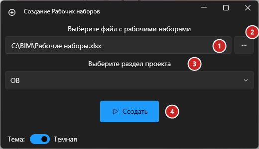
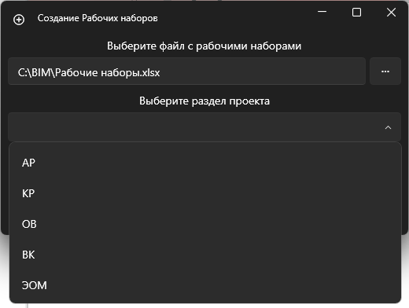
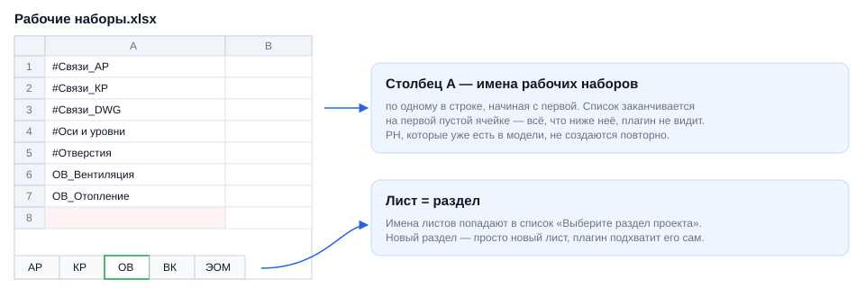

# Создание рабочих наборов

## Введение

Плагин создаёт в модели стандартный набор рабочих наборов (РН) для выбранного раздела — АР, КР, ОВ, ВК, ЭОМ и т. д. Списки РН берутся из общей Excel-таблицы BIM-отдела, поэтому у всех моделей одного раздела наборы называются одинаково.

Запуск — **Рабочие наборы → Создание наборов** на вкладке **ToadTools**, панель **BIM**.

## Порядок работы

### 1. Включите совместную работу

Плагин создаёт РН только в модели с совместной работой. Если она ещё не включена, нажмите в Revit **Совместная работа → Рабочие наборы** и задайте имена стандартным РН.

> [!WARNING]
> Без совместной работы плагин предупредит «В модели не включена совместная работа» — рабочие наборы в такой модели создать нельзя.

### 2. Создайте рабочие наборы

1. **Файл с рабочими наборами** — путь к Excel-таблице. По умолчанию — общая таблица `Y:\13-BIM (разработка)\06_Плагины\Рабочие наборы.xlsx`, менять его обычно не нужно.
2. **«…»** — выбрать другой файл на компьютере.
3. **Раздел проекта** — список берётся из имён листов таблицы:

   

4. **Создать** — создаёт РН выбранного раздела. Наборы, которые уже есть в модели, пропускаются, так что запуск можно повторять без опаски.

После создания появится итог — сколько наборов создано (или что все они уже есть в модели). Путь к файлу и тема окна запоминаются.

### 3. Освободите рабочие наборы

После создания вы — владелец всех новых РН, и коллеги не смогут в них работать.

Синхронизируйтесь с хранилищем с отмеченным **«Пользовательские рабочие наборы»**:

После синхронизации РН освобождены:

## Как устроена таблица

- **Лист** — раздел. Чтобы добавить раздел, добавьте лист с его названием — при следующем запуске он появится в списке.
- **Столбец A** — имена РН раздела, по одному в строке, начиная с первой. Первая пустая ячейка заканчивает список.
- Чтобы изменить набор РН раздела, отредактируйте его лист — плагин читает таблицу при каждом запуске.

> [!NOTE]
> Общую таблицу правит BIM-отдел. Если нужен свой набор РН — сделайте копию таблицы и укажите её кнопкой **«…»**.

## Если что-то пошло не так

| Проблема | Что делать |
|---|---|
| Список разделов пустой | Нет доступа к файлу таблицы (например, вы вне сети и диск `Y:` недоступен) — выберите локальную копию кнопкой «…» |
| «Пожалуйста, выберите раздел» | Выберите раздел в списке |
| «В модели не включена совместная работа» | Включите её — см. шаг 1 |
| Часть РН не появилась | В столбце A таблицы есть пустая строка — всё, что ниже неё, не читается |
