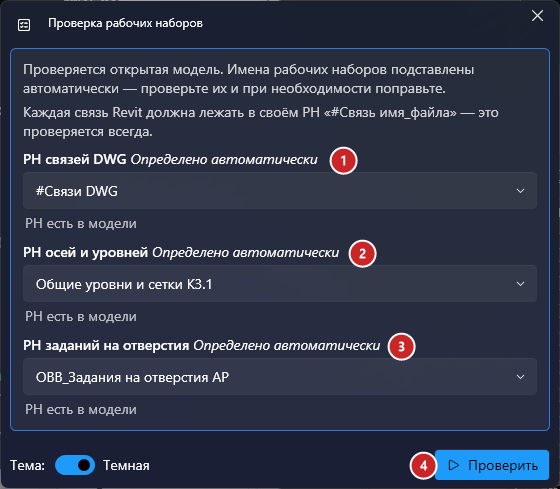
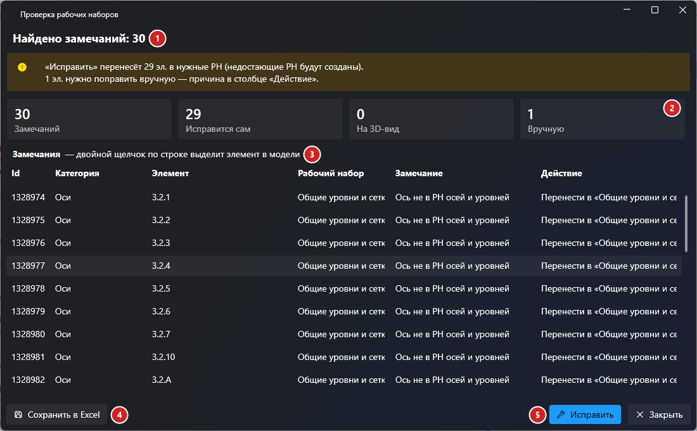

# Проверка рабочих наборов

## Введение

Плагин проверяет, правильно ли элементы **открытой модели** распределены по рабочим наборам (РН): где лежат связи, CAD-подложки, оси, уровни и задания на отверстия. Найденное показывается в отчёте, а кнопка **«Исправить»** сама переносит то, что можно перенести однозначно, и собирает остальное на 3D-виде.

Запуск — **Рабочие наборы → Проверка наборов** на вкладке **ToadTools**, панель **BIM**.

## Окно проверки

Плагин подставляет имена РН сам: значения из прошлого запуска, если такие РН есть в этой модели, иначе определённые автоматически. Рядом с названием поля написано, откуда взялось значение (*Как в прошлый раз*, *Определено автоматически* или *Не удалось определить — введите вручную*), а под полем — что нашлось в модели.

1. **РН связей DWG** — полное имя набора для всех CAD-подложек, например `#Связи DWG`, выбирается из списка РН модели. Связи Revit от этого поля не зависят: у каждой свой РН `#Связь <имя файла>`, и проверяются они всегда.
2. **РН осей и уровней** — полное имя набора.
3. **РН заданий на отверстия** — полное имя набора.
4. **Проверить** — запускает проверку. Во время проверки показывается прогресс, её можно остановить кнопкой «Прервать».

> [!NOTE]
> Если оставить поле пустым, соответствующая проверка пропускается.

## Отчёт

Если замечаний нет, появится сообщение «Рабочие наборы в порядке». Иначе откроется отчёт:

1. **Итог** — сколько замечаний и что с ними сделает «Исправить».
2. **Счётчики**: всего замечаний, сколько исправится автоматически, сколько попадёт на 3D-вид, сколько нужно поправить вручную.
3. **Таблица замечаний** — элемент, его РН, замечание и действие при исправлении. **Двойной щелчок** по строке выделяет элемент в модели.
4. **Сохранить в Excel** — выгружает таблицу в файл.
5. **Исправить** — переносит элементы, создаёт недостающие РН и собирает остальное на 3D-виде, затем проверяет модель заново: в отчёте останется только нерешённое. Исправление идёт одной операцией: «Прервать» откатывает всё, а после завершения всё отменяется одним **Ctrl+Z**.

Если есть элементы для 3D-вида, появится кнопка **«Открыть 3D-вид»**: она закроет отчёт и откроет вид **«Проверка РН»**. На нём изолированы элементы, которые лежат не в своём РН, но в какой РН их переносить, плагин определить не может. Раскидайте их по РН вручную.

## Что проверяется и как исправляется

| Элемент | Замечание | «Исправить» |
|---|---|---|
| Ось, уровень | Не в РН осей и уровней | Переносит в РН осей и уровней (создаёт его, если нет) |
| Связь Revit | Не в своём РН `#Связь <имя файла>` (имя файла без `.rvt`, например `#Связь Дом_АР`) | Переносит в него; если такого РН нет, создаёт. Вложенные связи не проверяются |
| CAD-подложка (DWG и др.) | Не в РН связей DWG | Переносит в него (создаёт его, если нет) |
| Прочие элементы модели | Лежат в РН связей DWG или `#Связь …`, в РН осей и уровней, в РН отверстий (там допускаются только обобщённые модели) | Собирает на 3D-виде «Проверка РН» |

Вручную придётся поправить:
- связь, имя файла которой содержит символы, недопустимые в имени РН (`{ } [ ] | ; < > ?` и т. п.);
- элемент, занятый другим пользователем, или изменённый в хранилище (сначала загрузите последние изменения);
- элемент без геометрии, который нельзя показать на 3D-виде (ищите его по Id).

> [!NOTE]
> Вид «Проверка РН» пересоздаётся при каждом исправлении. Вспомогательные элементы, у которых РН нельзя сменить отдельно (линии эскизов, вложенные семейства и т.п.), не проверяются. Элементы в закрытых РН тоже не проверяются: плагин перечислит такие РН в отчёте.

## Если что-то пошло не так

| Проблема | Что делать |
|---|---|
| Поле подставилось неправильно | Поправьте его вручную — в следующий раз плагин подставит ваше значение |
| Связь осталась в «Вручную» | Имя её файла нельзя использовать как имя РН — переименуйте файл связи или перенесите её в РН сами |
| Элемент «занят другим пользователем» | Попросите коллегу освободить его или дождитесь синхронизации и запустите проверку снова |
| Элемент «изменён в хранилище» | Загрузите последние изменения (Совместная работа → Обновить до последней версии) и повторите |
