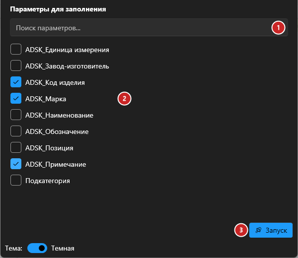
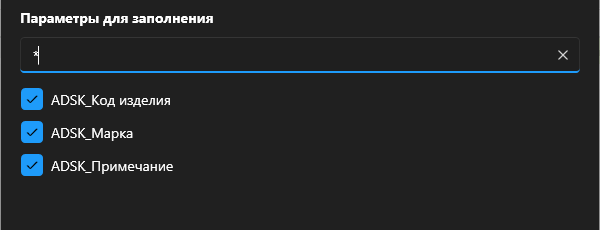

# Записать прочерк

## Введение

Команда записывает прочерк `-` в **пустые** текстовые параметры всех элементов модели — чтобы в спецификации вместо пустых ячеек стоял прочерк. Заполненные значения не трогаются.

Запуск — **Запись прочерков** на вкладке **ToadTools**, панель **Общие**.

## Как пользоваться

1. **Поиск параметров** — сужает список по части имени.
2. **Список параметров проекта** — отметьте те, в которые нужно записать прочерк.
3. **Запуск** — прочерк записывается во всех элементах модели. Во время работы показывается прогресс; «Прервать» откатывает изменения.

> [!TIP]
> Введите в поиск звёздочку `*` — останутся только отмеченные параметры. Удобно проверить, всё ли выбрано, перед запуском:
>
> 

## Что заполняется

| Значение параметра | Что сделает плагин |
|---|---|
| Пусто | Запишет `-` |
| Только пробелы | Запишет `-` |
| Любой текст, в том числе один символ | Не тронет |
| Параметр не текстовый (число, длина, да/нет) | Пропустит |
| Параметр только для чтения | Пропустит |

Обрабатываются все элементы модели (кроме аннотаций) и их **типы** — если параметр типовой, прочерк записывается в тип.

> [!WARNING]
> Плагин специально не перезаписывает заполненные значения, чтобы случайно не затереть нужную информацию и не сломать спецификацию.

## Если что-то пошло не так

| Проблема | Что делать |
|---|---|
| «Выберите параметры для записи!» | Отметьте хотя бы один параметр |
| Нужного параметра нет в списке | В списке только параметры проекта и общие параметры, добавленные в проект. Встроенные параметры Revit (Комментарии, Марка и т. п.) не показываются |
| Прочерк не появился | Параметр не текстовый или в нём уже есть значение (например, пробел с символом) |
